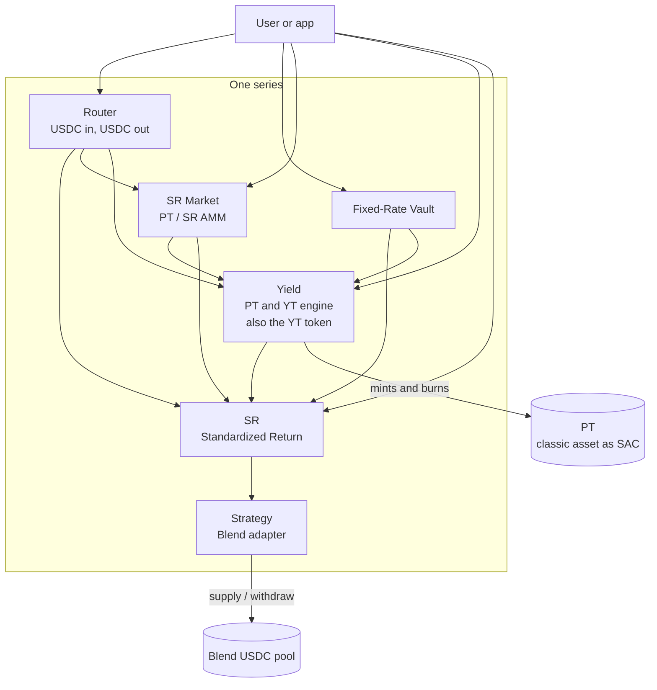
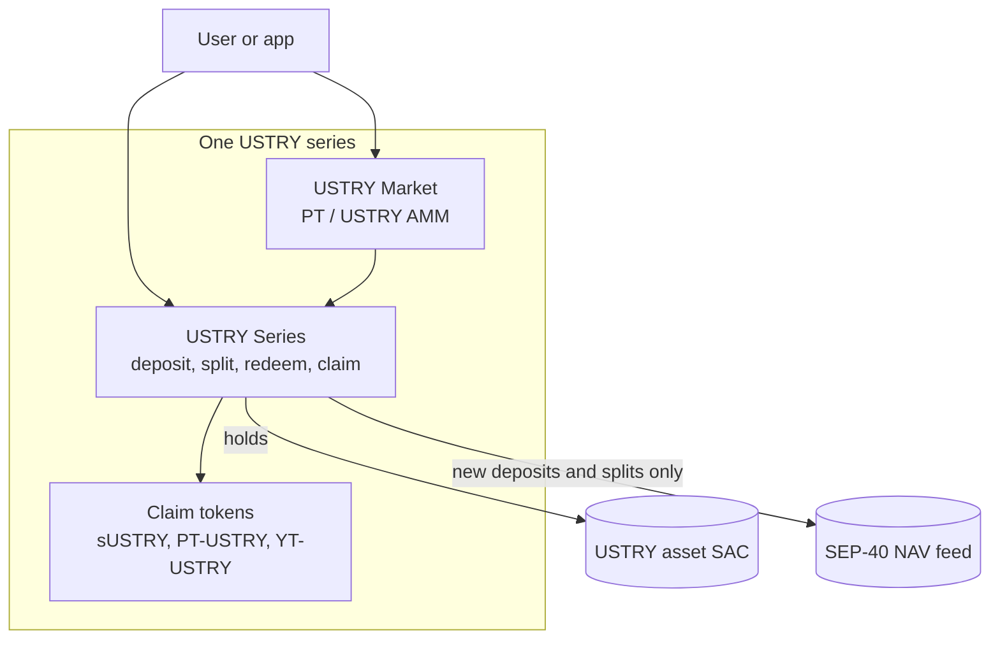

import { Callout } from 'fumadocs-ui/components/callout';

Spield is organized in **series**. Each series is a complete, separate set of contracts with its own
fixed maturity. Nothing is shared between series, and a maturity is never extended. A new maturity is
a new deployment.

This page maps the contracts and who calls whom. For function-level detail see
[Contracts](/docs/developers/contracts).

## A Blend series: six contracts

Every Blend USDC series is made of the same six contracts.

| Contract | Responsibility |
| --- | --- |
| **SR** (Standardized Return) | A yield-bearing share token over the Strategy. Deposit USDC, receive SR. Its `exchange_rate` is the yield oracle for everything above it. The per-series deposit cap lives here. |
| **Strategy** | A thin adapter between SR and the Blend lending pool. It is the only contract that knows Blend's shape. |
| **Yield** | Splits SR into PT and YT (`mint_py`) and recombines them (`redeem_py`). It tracks every YT holder's accrued interest, and **it is the YT token itself**. |
| **SR Market** | A PT/SR AMM. PT trades against SR, not raw USDC, so the quote side keeps earning while it sits in the pool. YT is traded through the same pool by minting and recombining pairs. |
| **Fixed-Rate Vault** | Deposit USDC, receive a receipt (an on-chain record, not a transferable token) that pays a fixed amount at maturity. Backed by PT the vault holds. |
| **Router** | A single-signature front door. It chains SR, the market and the engine so a user can pay and receive plain USDC. It holds no balances between calls. |

SR is the standard share interface that Spield builds PT and YT on. It plays the same role as Pendle's
SY (EIP-5115) wrapper, and the engine and market follow Pendle V2's design.

### The call graph points one way

Calls go downward only: **User, Router, Market, Yield, SR, Strategy, Blend**. Nothing calls back up, so
no contract in the series depends on a callback from a contract it called.

### Why YT is the Yield contract

YT is **not** a Stellar Asset Contract. Interest has to be settled for both sides **before** a YT
balance changes, and a SAC cannot run code on transfer. So the Yield contract is itself the YT token.
Every `transfer`, `transfer_from` and `burn` first settles both parties' accrued interest at the
current index (an internal hook, `before_yt_change`). That is what makes YT safe to trade on a market.
Point your code at the Yield contract address when you mean YT.

### Why PT is a classic asset

PT is the classic Stellar asset `SPLDPT` (the code varies by series), wrapped as a SAC. Each series
gets **its own issuer account**. That issuer is locked after setup, with every signer weight at zero,
so no key can ever mint PT. The only minter is the Yield contract, which is the SAC's admin. Because
the code is not unique across series, always compare the full `CODE:ISSUER`. See [Tokens](/docs/developers/tokens).

### Immutable maturity

A series' expiry is set once at initialization and cannot change. Before expiry you can mint, trade,
add liquidity and exit. After expiry, minting, swaps and `add_liquidity` stop. PT redeems 1:1,
vault receipts redeem, YT yield can still be claimed and liquidity can still be removed.

## The USTRY series family

Spield's second yield source is **USTRY**, Etherfuse's tokenized US Treasuries. It is a separate set of
contracts, not a variant of the Blend six. It is **live on testnet only today**.

| Contract | Responsibility |
| --- | --- |
| **USTRY Series** | Takes USTRY deposits. Issues unsplit receipts (sUSTRY) or splits them into equal USD-face PT and YT, folds new NAV readings into a high-water mark, and finalizes at maturity. |
| **USTRY Market** | A PT/USTRY AMM with the same curve family as the SR Market. |
| **Claim tokens** | Three SEP-41 tokens (receipt, PT, YT) whose balances are read from the series. They are contract tokens, so there is no trustline for them. |
| **NAV feed** | Any SEP-40 price feed. RedStone's on mainnet, a Spield-run feed on testnet. |

How the NAV is used is the key design rule:

- **Only new deposits and splits read the feed.** A stale or broken feed can stop new minting. It cannot stop anyone leaving.
- **Exits never call the oracle.** Combining, redeeming, claiming, YT transfers and burns, and LP removal all run on stored state.
- **The NAV high-water mark never falls**, and it can rise by at most `max_apr_bps` per year (bounded twice: per step and in total since the series' first sample).
- **Finalization at maturity cannot be bricked by the feed.** It happens on a post-expiry sample, or after a grace period without calling the oracle at all.
- **Prices are never taken from DEX trades.**

PT and YT in a USTRY series are denominated in **USD face**, but payouts are in **USTRY units**. USD face
is not a principal guarantee. See [USTRY treasury series](/docs/how-it-works/treasury-series) for the
product view.

<Callout type="warn" title="USTRY issuer powers">
  The USTRY asset's issuer can freeze balances and claw back tokens. A clawback from the series
  freezes USTRY payouts until restored, and a clawback from the market's pool closes trading and
  pays LPs pro rata from what remains. This is an inherited property of the asset, and the contracts
  are written so an LP can always remove liquidity without calling the oracle.
</Callout>

## Design properties

### The yield source sits behind one adapter
SR talks to the Strategy through a stable interface, and everything above SR only sees SR's
`exchange_rate`. That is how Spield added USTRY without changing how PT and YT behave for Blend
users.

### Products compose, they do not duplicate
The vault, the market and the router are all *users* of the engine and SR, not reimplementations.
The vault mints PT through the engine, the market trades the PT the engine produces, and the router
only chains calls that already exist. You can still call SR, the market or the engine directly.

### A paused router removes convenience, never access
Pausing is for new exposure. Exits stay open, and the contracts underneath can be called directly.

## Trust model

| Area | Trust level |
| --- | --- |
| **Yield and solvency** | Derived from the yield source's real on-chain rate and checked by contract invariants (for the engine: SR held covers what is owed). The `solvency()` view shows it. |
| **PT supply** | Only the Yield contract can mint PT. The issuer account is locked and has no signing weight. |
| **Admin** | The admin of every mainnet contract is a **2-of-3 multisig** account. See [Contract addresses](/docs/developers/addresses). |
| **Admin powers** | Bounded: pause new exposure (exits stay open), set the yield fee and market fee within on-chain ceilings, and schedule upgrades behind an on-chain timelock whose pending hash is public. |
| **Yield source** | An inherited dependency. Blend pool health (and, for USTRY, the NAV feed and the asset issuer) are risks Spield passes through. |

A **Guarded Launch Cap** limits each series' SR deposits (`deposit_cap`), and the Fixed-Rate Vault's
rate can never be set above its on-chain ceiling (`max_rate_bps`). For the safety mechanics, see
[Solvency](/docs/how-it-works/solvency) and [Understanding the risks](/docs/resources/security).

## Verifiable builds

Every contract exposes `code_hash()` (the live WASM hash) and `version()`, so you can confirm which
build is running and that an upgrade took effect. Pause state, admin and any pending upgrade are
readable too. See [Reading state](/docs/developers/reading-state).
