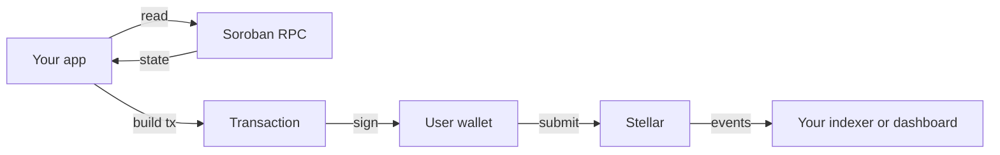

import { Callout } from 'fumadocs-ui/components/callout';
import { Card, Cards } from 'fumadocs-ui/components/card';

Spield is built on **Stellar's Soroban smart contracts**, and its tokens and contracts are open and
composable. This section is for developers integrating Spield into an app, indexing its data, or
building products on top of PT and YT.

<Callout title="What this section covers">
  These docs describe Spield's **public interface**: the SDK, the contract entry points you call, the
  tokens you hold, the state you can read and the events you can index. You do not need anything
  else to integrate.
</Callout>

## Where to start

The fastest path is the TypeScript SDK. It picks the series, converts amounts, adds trustlines,
simulates, signs and confirms.

```bash
npm install @spield/sdk
```

```ts
import { SpieldClient } from '@spield/sdk';

const spield = new SpieldClient();                 // testnet; use mainnet() for the public network
await spield.loadSeries();
const info = await spield.series('testnet-blend-3').getInfo();
console.log(info.impliedApyPct, info.actions);
```

<Cards>
  <Card title="@spield/sdk" href="/docs/developers/sdk" description="Install, choose a series, read, buy PT, redeem, wallets, errors." />
  <Card title="Architecture" href="/docs/developers/architecture" description="The six contracts of a series, how they call each other, and the USTRY family." />
  <Card title="Contracts" href="/docs/developers/contracts" description="The public entry points of each contract, reads and writes." />
  <Card title="Tokens" href="/docs/developers/tokens" description="SR, PT, YT, USDC, USTRY and its claim tokens, and how to handle their units." />
  <Card title="Reading state" href="/docs/developers/reading-state" description="Positions, prices, solvency and series status. Free, no signing." />
  <Card title="Integrating" href="/docs/developers/integrating" description="Send transactions with the SDK or with raw contract calls." />
  <Card title="Events" href="/docs/developers/events" description="The on-chain events Spield emits, for dashboards and indexers." />
  <Card title="Contract addresses" href="/docs/developers/addresses" description="Every series on mainnet and testnet, and how to discover new ones." />
</Cards>

## How Spield is organized

Spield runs in **series**. A series is a complete set of contracts with one fixed, immutable maturity.
A new maturity is a new series, so there is no "the" contract address. You choose a series by id.

| Layer | Technology |
| --- | --- |
| Smart contracts | Soroban (Rust), on Stellar |
| Per-series contracts | SR, Yield (PT/YT engine and the YT token), SR Market, Fixed-Rate Vault, Router, Strategy |
| Tokens | PT is a classic Stellar asset wrapped as a SAC. SR and YT are contract tokens. |
| Yield sources | Blend USDC lending (mainnet and testnet). Tokenized US Treasuries, USTRY (testnet only today). |
| Reads | Soroban RPC `simulateTransaction` (free, no signing) |
| Writes | Build, simulate, sign (wallet), submit, poll |
| Client | `@spield/sdk` (recommended), or `@stellar/stellar-sdk` directly |

## The shape of an integration



- **Reads** are free simulations. Query positions, prices and solvency with no wallet and no fees.
- **Writes** are standard Soroban transactions signed by the user's wallet.
- **Events** let you rebuild a series' activity for dashboards or analytics.

## Conventions used in these docs

- **Base units.** All token amounts on chain are integers in base units. USDC, SR, PT and YT use **7 decimals**: `10000000` is `1.0`. See [Tokens](/docs/developers/tokens).
- **Fixed-point rates.** Rates and prices use 12-decimal fixed point. `1000000000000` is `1.0`.
- **Function names** are shown exactly as they appear on chain (snake_case), for example `mint_py`.
- **Compare `CODE:ISSUER`.** PT assets share a code across series, so always compare the issuer too.

<Callout type="info" title="Where Spield is live">
  Spield v2 has been live on mainnet since September 2026. Both mainnet series so far have matured
  and are redeem-only. Testnet has live series, and USTRY is testnet only. See
  [Contract addresses](/docs/developers/addresses) for every series.
</Callout>
