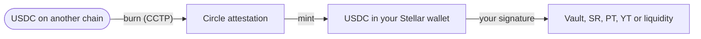

import { Callout } from 'fumadocs-ui/components/callout';
import { Step, Steps } from 'fumadocs-ui/components/steps';

Most people's USDC lives on another chain. Spield's cross-chain support lets you **bring USDC
in**, and **take it back out**, without routing through an exchange. It is built on **Circle
CCTP V2**, which **burns** native USDC on the source chain and **mints** native USDC on
Stellar once Circle attests the burn. You end up with real USDC, not a wrapped copy.

<Callout type="info" title="The bridge is a convenience at the edge, not part of the core">
  The bridge only moves USDC across chains. Once it arrives, it is ordinary Stellar USDC and
  everything Spield does with it is bridge-free. Your position has no ongoing cross-chain
  dependency. See [Why Stellar?](/docs/introduction/why-stellar).
</Callout>

## Where it appears

The bridge is not a separate trip. Every action panel has a cross-chain option:

| Panel | In from another chain | Out to another chain |
| --- | --- | --- |
| **Fixed Vault** | Deposit into the vault | Redeem a matured receipt |
| **SR Wrapper** | Wrap into SR | Unwrap SR |
| **Liquidity** | Add liquidity | Remove liquidity |
| **Deposit** | Mint PT and YT | Combine or redeem PT |
| **Markets** | Buy PT or YT (**Pay with** another chain) | Sell PT or YT (**Receive in** another chain) |

It works for **Blend** series and **Treasury (USTRY)** series. For a USTRY target the app
also swaps the arriving USDC into USTRY on the Stellar exchange before the final step.

There is also a plain **Bridge** page in the sidebar. It brings USDC to your Stellar wallet and
offers a **maturity choice**, so you can send it straight into the series you want.

## Supported chains

<Callout type="info" title="Chain lists can grow">
  The list below is what the app supports today. Circle adds chains over time, so check the
  chain dropdown in the app for the live list.
</Callout>

| Network | Mainnet source | Testnet source |
| --- | --- | --- |
| Ethereum | Ethereum | Ethereum Sepolia |
| Base | Base | Base Sepolia |
| Arbitrum | Arbitrum | Arbitrum Sepolia |
| OP | OP Mainnet | OP Sepolia |
| Polygon | Polygon | Polygon Amoy |
| Avalanche | Avalanche | Avalanche Fuji |
| Solana | Solana | Solana Devnet |
| Others (testnet only) | None | Unichain Sepolia, Linea Sepolia, Arc Testnet |

Connect an **EVM wallet** for the EVM chains, or a **Solana wallet** for Solana. The destination
is always your **Stellar wallet**. Some chains support Circle's **Fast** transfer (the app labels
each chain "Standard + Fast", "Fast only" or "Standard"), and Fast is the only mode on
testnet. Standard takes longer because Circle waits for source-chain finality.

## How a deposit works

<Steps>

<Step>
### Choose where it goes

On the panel you are using, pick **Pay with** your source chain. Enter the amount. The app shows a
quote including Circle's fee and the amount you will receive.
</Step>

<Step>
### Approve and burn on the source chain

Your source-chain wallet approves and burns the USDC. You need a little of that chain's **gas
token** (ETH, POL, AVAX, SOL).
</Step>

<Step>
### Circle attests

Circle signs an attestation for the burn. The app waits for it.
</Step>

<Step>
### The USDC lands in your Stellar wallet, then the final step runs

Circle's protected Stellar forwarder mints the USDC to **your own Stellar wallet**. The app then
runs the last action (vault deposit, buying PT, adding liquidity, and so on), which you sign.
</Step>

</Steps>

Exits are the mirror image: the app redeems or sells into USDC in your Stellar wallet, burns it
on Stellar, waits for Circle, and you sign the **receive** on the destination chain (your EVM
wallet pays that gas).

## Journeys you can resume

A cross-chain action is several steps over several minutes, so the app runs it as a **journey**
that is built to survive interruptions:

- **Every step re-reads the chain first.** A step is never repeated. If the app sees the burn
  was already received, or a balance already moved by the expected amount, it moves on.
- **You can resume by hash.** The journey is saved as soon as the burn hash is known, before it
  is confirmed. If you close the tab, lose your connection, or a signature is sped up, open
  **Recent transfers** and press **Resume**, or paste the burn hash into **Resume by hash**
  on the Bridge page.
- **A burn that fails leaves nothing bridged.** If it reverts or never lands, nothing moved.
- **Funds always stop in your own wallet.** Nothing is ever parked in a Spield contract on your
  behalf. If a journey is interrupted, what you hold is plain USDC in your own Stellar wallet
  (or already minted to your own address on the destination chain), never a stuck intermediate.
- **A price guard on the market step.** If a swap or market fill would be **more than 2% worse**
  than what you reviewed, the journey stops and asks you instead of going ahead.

## Testnet: the USDC desk

Circle's test USDC is not the same asset as the test USDC that Blend's testnet pool uses. So on
testnet, after the USDC arrives, the app swaps it **1:1** into the pool's test USDC on a
Spield testnet desk, with a **99% minimum** so a worse fill fails instead of losing funds. Exits
reverse it. Mainnet has no such step, because there both are Circle's USDC.

## Good to know

- **Fees and timing** depend on the source chain, the transfer mode and network conditions.
  Circle's fee is shown in the quote before you confirm, and the burn carries a maximum fee so
  it cannot be exceeded.
- **You need the source chain's gas token** for the burn, and gas on the destination chain for
  an exit.
- **Always review the quote** and the destination address before confirming.

<Callout type="warn" title="Bridging carries its own risks">
  Cross-chain transfers are separate infrastructure with their own risk profile. CCTP is
  Circle's native-USDC mechanism, which avoids wrapped tokens, but any cross-chain flow is higher
  risk than a same-chain transfer. If you prefer, withdraw USDC directly on Stellar from an
  exchange. See [funding your wallet](/docs/getting-started/funding-your-wallet).
</Callout>

## Related

- Walkthrough: [Bridge USDC to Stellar](/docs/guides/bridge-usdc)
- After bridging: [Your first deposit](/docs/getting-started/your-first-deposit)
