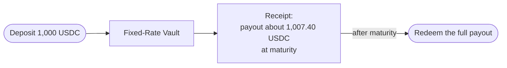

import { Callout } from 'fumadocs-ui/components/callout';
import { Step, Steps } from 'fumadocs-ui/components/steps';

The **Fixed-Rate Vault** is the simplest way to use Spield. You deposit USDC, you are told an
exact payout for an exact date, and you get a **receipt** for it. No PT, no YT, no trading.

## What it does

> Deposit USDC, get a guaranteed payout at maturity.

When you deposit, the vault:

1. Shows a **live quote**: your guaranteed payout (principal plus a fixed coupon) and the fixed APY.
2. Records a **receipt** for that exact payout under your address.
3. After maturity, lets you **redeem** the receipt for the full amount in USDC.

The coupon is simple interest at the vault's fixed rate for the time left to maturity
(principal x rate x days left / 365). Mainnet Series 1 and Series 2 both used **3.00%**.

## Why the rate is truly fixed

The vault does not predict a rate and hope. It only promises a payout it already holds the means
to pay. Every receipt is backed by **principal tokens (PT) the vault holds in inventory**, and
PT redeems 1:1 at maturity. So a payout can only be quoted if backing for it already exists. If
the vault cannot fully back a deposit's payout, it **declines the deposit** rather than
over-promise. The check runs on every deposit and every redemption.

<Callout title="The practical effect">
  Your payout is locked the instant you deposit. Market rates can swing afterward and your
  receipt still pays what it said. You cannot be liquidated, because there is no leverage in a
  vault deposit.
</Callout>

How the vault funds the coupon: it also holds the YT that matches its PT, and that YT earns
Blend yield. Before a vault is launched, its rate is checked against what Blend pays (see
[the yield source](/docs/how-it-works/yield-source#the-fixed-rate-vaults-rate-is-checked-against-blend)).

## Using the vault

<Steps>

<Step>
### Open the Fixed Vault page

In the app sidebar, select **Fixed Vault**. Make sure the right series is selected in the header.
</Step>

<Step>
### Enter an amount and read the quote

Type your USDC amount. The vault shows your **fixed payout at maturity**, the coupon, the
locked APR and the maturity date. You can also fund the deposit with USDC from another chain
(see [Cross-chain bridge](/docs/features/cross-chain-bridge)).
</Step>

<Step>
### Deposit

Confirm and approve in your wallet. USDC goes into the vault in one signature and you get a receipt.
</Step>

<Step>
### Redeem after maturity

After the maturity date, open your receipts and **redeem**. You can have the USDC paid to your
Stellar wallet or sent to another chain.
</Step>

</Steps>

## Good to know

- **One term per vault.** Each series has its own vault with one maturity date. When that term
  ends, a new series is offered. See [Series and maturities](/docs/how-it-works/series-and-maturities).
- **A receipt is a record, not a token.** It is stored on-chain under your address and pays that address.
- **The rate may change for *new* deposits.** The quoted rate can be adjusted for future
  deposits, within an on-chain ceiling (20%). **Receipts already issued never change.**
- **Capacity is limited.** The vault can only promise as many payouts as it can back. When it has
  no spare capacity it shows that and refuses deposits, which is the safety mechanism, not a fault.
  Each series also has a deposit cap.
- **Redeeming is never blocked by a pause.** An exit stays open.
- **If cash is short at exit time,** the vault pays what it can right away, and you redeem again
  for the rest later. What it already paid you stays paid.

<Callout type="warn" title="Fixed while the yield source is healthy">
  The payout is fixed as long as the underlying Blend position is healthy. If Blend ever lost
  value, the vault shares that loss across all open receipts pro rata, transparently, instead of
  favouring whoever exits first. See [Solvency](/docs/how-it-works/solvency#what-solvency-does-not-cover).
</Callout>

<Callout type="info" title="Want more control?">
  To hold the bond yourself (to trade it, provide liquidity with it, or claim yield directly),
  use the **Deposit** page to [mint PT and YT](/docs/features/pt-yt-tokens) instead. The vault is
  the hands-off option. PT and YT is the hands-on one.
</Callout>

## Related

- Walkthrough: [Earn a fixed yield](/docs/guides/earn-fixed-yield)
- After maturity: [Redeem at maturity](/docs/guides/redeem-at-maturity)
- Concept: [PT and YT explained](/docs/how-it-works/pt-and-yt)
