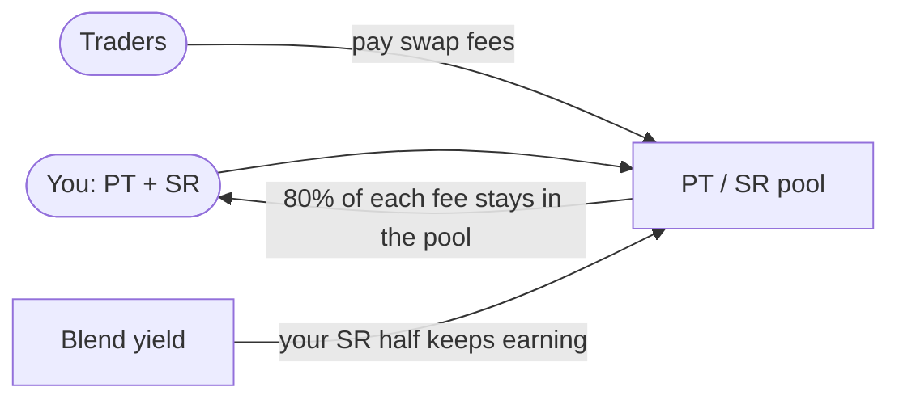

import { Callout } from 'fumadocs-ui/components/callout';
import { Step, Steps } from 'fumadocs-ui/components/steps';

**Liquidity providers (LPs)** supply assets to the market so others can trade, and earn a share
of the **swap fees**. Spield's design adds two things most pools lack: your non-PT half **keeps
earning yield**, and the curve is built around PT's walk to par, so holding to maturity does not
mean losing money to that walk.

## What you provide

You supply **PT and SR** to the series' market, in the pool's current ratio. SR is Spield's
[yield-bearing share token](/docs/how-it-works/standardized-return). In return you receive **LP
shares** that represent your proportional claim on the pool.

You do not have to hold SR yourself. In the app you enter an amount and it **wraps USDC into SR,
then adds it alongside the PT in your wallet** (two signatures, shown step by step; the wrap is
skipped if you already hold enough SR). You do need PT, which you can get by
[minting PT and YT](/docs/features/pt-yt-tokens) or buying PT on the market.

## How you earn

LPs earn from three sources at once:

1. **Swap fees.** **80% of every swap fee** stays in the pool for LPs. The other 20% goes to the
   protocol. PT trades and YT trades pay the same split, so no route is cheaper than another.
   Fees are not paid out separately. They raise the value of each LP share.
2. **Yield on the SR half.** In a PT/USDC pool the USDC half would earn nothing while it sat
   there. Here it is SR, which keeps earning the Blend yield the whole time.
3. **PT's walk to par.** The curve expects PT to climb toward 1.0 and prices accordingly.

Fees depend on trading volume, so returns vary. See [Protocol fees](/docs/features/protocol-fees).

## The impermanent-loss picture

On a normal AMM, providing liquidity to an asset that is steadily appreciating, like PT rising
to par, systematically costs you: you would sell the appreciating asset too cheaply. Spield's
market **anticipates** that move instead of fighting it, and keeps converging on par as time
runs out.

<Callout title="Built for holding to maturity">
  An LP who provides liquidity and **holds to maturity** is not hurt by PT's predictable climb to
  par, and collects fees and SR yield the whole time. That is the core reason to LP on Spield.
</Callout>

This is not "zero risk". If yields move unexpectedly, the pool's balance shifts and your position
can be worth more or less than simply holding. Exiting early takes the pool's price at that moment.
The benefit is strongest for LPs who stay to maturity.

## Adding liquidity

<Steps>

<Step>
### Open the Liquidity page

Select **Liquidity** in the app sidebar and check the series in the header.
</Step>

<Step>
### Enter an amount

Enter how much you want to add. The app works out the matching amount of the other asset at the
pool's current ratio, so your deposit does not move the price. Deposits must match the pool's
ratio. The first LP into a brand-new pool sets the starting ratio, and the pool opens at the
market's configured rate whichever ratio is used.
</Step>

<Step>
### Confirm

Approve in your wallet. You receive LP shares and start earning on the next trade. You can also
fund an add from USDC on another chain (see [Cross-chain bridge](/docs/features/cross-chain-bridge)).
</Step>

</Steps>

A small slice of the first deposit's shares (1,000 units) is permanently locked in a new pool.
That is a standard guard against share-price manipulation and is negligible next to real deposits.

## Removing liquidity

You can **remove liquidity at any time**, including **after maturity** and even if the market is
paused. There is no lock-up. Use the percentage slider to withdraw part or all of your position.

On Stellar, removal returns **PT and SR** (your proportional share of each, with the fees and
yield already included in their value). From there the app can:

- unwrap the SR to USDC,
- **sell the PT** on the market before maturity, or **redeem it at face** after maturity,
- or send the result to another chain.

<Callout type="info" title="LPs can always exit">
  Removing liquidity is never blocked by maturity or by a pause. Swaps and adding liquidity
  stop at maturity. Exits do not.
</Callout>

## Things to keep in mind

- **You need PT to provide liquidity.** Get it by minting or buying.
- **Fees vary with volume.** Your return depends on how much trading flows through the pool.
- **After maturity** the pool no longer trades, so there are no new fees. Remove your
  liquidity and redeem.
- **Each series has its own pool.** A matured series' pool is exit-only.

## Related

- Walkthrough: [Provide liquidity](/docs/guides/provide-liquidity)
- The venue you are providing to: [The yield market](/docs/features/yield-market)
