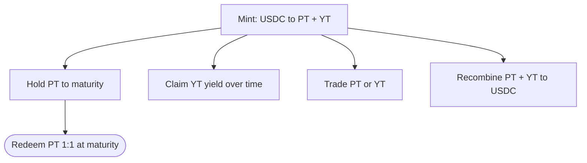

import { Callout } from 'fumadocs-ui/components/callout';

PT and YT are the core building blocks of Spield. The [Fixed-Rate Vault](/docs/features/fixed-rate-vault)
keeps them behind the scenes. The **Deposit** page mints them straight to your wallet so you can
use them however you like.

## What they are

| Token | Represents | What it is on Stellar |
| --- | --- | --- |
| **PT** (Principal Token) | Your principal. Redeems for 1 USDC of value at maturity. | A **classic Stellar asset** (code `SPLDPT`, wrapped as a contract token). Needs a trustline. |
| **YT** (Yield Token) | All yield the position earns until maturity. | The **yield contract itself**. A contract token with no trustline. |

- **PT** shows up in your wallet like any asset, can be transferred, traded on Spield's market,
  and supplied as liquidity. Each series has its own PT, issued by a **locked** issuer so no
  one can ever mint extra. Always compare the full `CODE:ISSUER` (see [Tokens](/docs/developers/tokens)).
- **YT** is a contract token, so some wallets may not display it as a standard asset. The
  Spield app always shows your balance. YT needs custom behaviour on every transfer, which is
  why it is not a classic asset.

## Minting at par

On the **Deposit** page, deposit USDC and the protocol mints **equal amounts** of PT and YT to
your wallet (for example, 100 USDC gives 100 PT and 100 YT). Minting is **at par, with no curve
and no spread**. The app wraps your USDC into [SR](/docs/how-it-works/standardized-return) first
and then splits it, which takes **two signatures** and is shown step by step.

## What you can do with them

### Hold PT for a fixed return
Keep PT to maturity and redeem it 1:1. The discount you effectively paid is your locked return.

### Claim YT yield
On the **Yield** page you see what your YT has earned (**Claimable now**), the 5% **protocol
yield fee**, and how long it keeps accruing. **Claim** pays the yield out in USDC in one
signature, and **your YT is untouched**, so it keeps earning until maturity. After maturity,
earned yield stays claimable with no deadline.

### Redeem PT at maturity
At or after maturity, redeem PT for USDC at par. You need only the PT. The Deposit page's
**Redeem** mode (the same card that mints) does this.

### Recombine to exit early
Hold equal PT and YT and **combine** them back into USDC any time before maturity, at par,
with no spread. Pending yield is credited first, so you lose nothing.

### Trade either token
Sell PT for a quick exit at the current market price, or buy PT for fixed exposure. YT is bought
and sold on the same [market](/docs/features/yield-market). On the Markets page you choose
PT or YT, then Buy or Sell, and pay or receive in **USDC or SR**.

## Yield follows the YT, not the person

When YT moves (a transfer, a trade, a mint or a burn), a hook first **settles both sides** at the
current yield index. So:

- You earn only on YT you actually held, for exactly the time you held it.
- A buyer can claim only yield that accrued **after** they acquired the YT. What you earned
  before you sold stays yours to claim.
- There are **no numbered positions**. All your YT is one balance with one claim, however many
  purchases made it up. The app's **Your Positions** panel shows that single balance.

<Callout title="Why this matters">
  Because settlement happens inside the token itself, YT can be freely moved between wallets,
  markets and other apps without any yield being double-counted or lost.
</Callout>

## Trustlines

- **PT** needs a one-time trustline to the series' PT asset. The app offers to add it with a
  single approval. You need it to **receive** PT, so minting or buying PT requires it.
- **YT** needs **no trustline**. Buying only YT does not deliver PT, so it needs no PT trustline either.

See [Trustlines](/docs/getting-started/trustlines).

## Related

- Concept deep-dive: [PT and YT explained](/docs/how-it-works/pt-and-yt)
- Build with them: [Spield's tokens for developers](/docs/developers/tokens)
