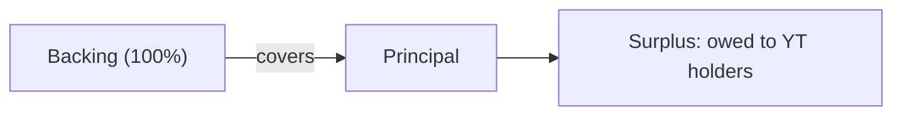

import { Callout } from 'fumadocs-ui/components/callout';

The **Solvency** page is Spield's transparency feature. It turns the
[solvency invariant](/docs/how-it-works/solvency) into something you can watch live, so you
never have to take safety on faith. You find it in the app sidebar, in the **Verify** group,
and a compact version also sits on the Overview page.

It always shows the **series you have selected** in the header. Each series is a separate set
of contracts with its own books.

## What the Blend series page shows

The top card reads **Solvent** (or **Under-backed**, if it ever failed) and a
**Collateralization** percentage. Three figures sit under a bar, all read **directly from the
chain**:

| Figure | Meaning |
| --- | --- |
| **Backing** | What the series holds, valued in USDC at the live rate. |
| **Principal** | The face value of every outstanding PT. |
| **Surplus** | Backing above principal, which is interest YT holders have earned. |

As long as **Backing is at least the amount owed**, the series is solvent, and the contracts
refuse any transaction that would break that. The card links to the yield contract that
enforces it and shows the exact read it is based on (`solvency()`).

Below it, **Risks you are taking** lists what could go wrong, in plain words:

- **The deposit cap**: the series cap, how much is deployed, and the **room left**. The cap
  gates deposits only and never blocks a withdrawal.
- **Quoted value vs what actually exists**: SR remembers its highest rate, so after a real
  loss the displayed value could be higher than what a withdrawal pays. This panel compares the
  two and shows any shortfall, so the warning is a measurement rather than a claim.
- **The risk list**: a deep bad-debt event at Blend, a Blend liquidity crunch that delays exits,
  the fact the contracts are **not audited**, and why the PT issuer must stay locked.

## What a Treasury (USTRY) series shows

Treasury series have their own Solvency page, in tokens rather than dollars:

| Figure | Meaning |
| --- | --- |
| **Backing** | USTRY the series holds. |
| **Obligations** | Unsplit receipts plus the USTRY allocated to PT and YT. |
| **Surplus** | Unallocated USTRY, including rounding. Not a promised yield payout. |

The card reads **Covered** when backing meets obligations. It states clearly that coverage is
in **USTRY, not dollars**, and lists the caps, the maturity, and the risks that matter there:
NAV can fall, new deposits depend on the price feed, issuer controls apply, and cash exits depend
on exchange liquidity. See [Treasury series](/docs/how-it-works/treasury-series).

## Why it is trustworthy

This is not a marketing number or a periodically updated report. The dashboard:

- **Reads live on-chain state.** What you see is the series' actual position right now.
- **Is permissionless to verify.** Anyone can query the same figures from the contract with no
  special access.
- **Shows the same numbers the contracts enforce.** The check that rejects an unsafe
  transaction uses the same books.

<Callout title="Do not trust, verify">
  Because the figures come straight from the chain, you (or anyone) can confirm a series'
  solvency independently at any moment. See
  [reading protocol state](/docs/developers/reading-state) for how to query it in code.
</Callout>

## Also worth a look

The **Activity** page, next to Solvency, lists the on-chain deposits, claims and redemptions
read from the contracts. Together they let you follow the money without taking anyone's word.

## Related

- The mechanism behind it: [Solvency](/docs/how-it-works/solvency)
- Query it yourself: [Reading protocol state](/docs/developers/reading-state)
