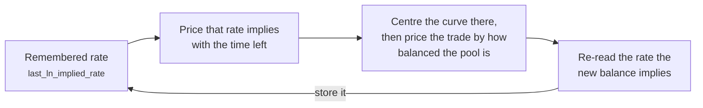

import { Callout } from 'fumadocs-ui/components/callout';
import { Tab, Tabs } from 'fumadocs-ui/components/tabs';

The **market** is where PT and YT change hands. It is a purpose-built **time-decay AMM**, an
automated market maker whose pricing knows that PT marches to par and YT's future yield
shrinks as maturity approaches. You never see curve math. You see a Buy or Sell choice for
PT or YT, and a headline rate.

Each series has its own market, with its own prices. You pick the series in the app header.

## What the pool trades: PT against SR

The pool holds **PT** and **SR**, not PT and plain USDC. [SR](/docs/how-it-works/standardized-return)
is Spield's yield-bearing share token. Pairing PT with SR means the pool's non-PT half **keeps
earning Blend yield while it sits there**, which is good for liquidity providers.

You do not need to hold SR to trade. When you pay with USDC, the app (through the Router) wraps
it into SR for you, and when you sell it can unwrap back to USDC. The trade panel has **Pay
with** and **Receive in** choices (USDC or SR) and a **"How your funds move"** strip that shows
each hop and how many wallet signatures it takes.

## The headline: implied APY

The market's main number is the **implied APY**: the annualized return you would lock in by
buying PT now and holding to maturity. It comes from the pool's price and the time left,
and it updates as people trade.

<Callout title="Implied vs realized">
  The **implied APY** is the market's current expectation of yield. The **realized APY** is
  what actually accrues. A gap between them is the opportunity: if you think realized yield
  will beat the implied number, that is a reason to buy YT. If you think it will fall short,
  lock the fixed rate by buying PT.
</Callout>

## Buying and selling

<Tabs items={['Buy PT', 'Buy YT', 'Sell']}>

<Tab value="Buy PT">

**Buy PT** gives a fixed return. You pay USDC (or SR) and receive PT at a discount, then hold it
to maturity for a return locked in at today's implied APY. USDC to PT is **one signature**.

- Best for: savers who want certainty and like the current fixed rate.
- To exit early: sell the PT back at the then-current price.

</Tab>

<Tab value="Buy YT">

**Buy YT** is leveraged yield exposure. Behind the scenes the market mints PT and YT from SR,
keeps the PT in the pool and hands you the **YT**. A little capital buys the yield of a much
larger position. You name the YT amount and the most you will spend, and any change is refunded.

- Best for: traders who think realized yield will exceed the implied APY.
- With USDC, it takes **two signatures** (wrap, then buy). With SR, **one**.
- The market refuses to sell YT if PT would be priced at or above par.
- This is the higher-risk side. See [risks](/docs/resources/security).

</Tab>

<Tab value="Sell">

**Sell PT or YT** back to the pool for SR, or for USDC if you chose to receive USDC. Selling YT
**credits the yield you already earned** before the balance moves, so you do not lose it. You
can still claim it afterward.

</Tab>

</Tabs>

## Why a time-decay curve

A normal AMM has no concept of time. It would force liquidity providers to fight PT's natural
rise to par, losing money along the way. Spield's curve **expects** PT to drift to par and
prices accordingly, so:

- **Traders** get prices that reflect the time-aware value of PT and YT.
- **Liquidity providers** are not systematically picked off by PT's climb to par (see
  [Liquidity](/docs/features/liquidity)).

## The fee scales with time to maturity

Every trade pays a fee, and the fee depends on how much time is left:

```text
fee rate = exp( ln_fee_root x years to maturity )         always 1.0 or more
buy PT   : you pay    price x fee rate
sell PT  : you get    price / fee rate
```

`ln_fee_root` is an **annualized** rate, set per market (Spield's launch configuration uses
0.25% a year, with an on-chain ceiling of 5% a year). In plain terms:

- **Far from maturity the fee is larger. At maturity it is zero.** A 90-day market charges
  about 0.06% of notional on a PT trade. A 30-day market charges about 0.02%.
- The fee is a roughly **constant share of the yield being traded**, whatever the maturity. A
  flat percentage of notional would be tiny against a long market's yield and huge against
  a short one's.
- **YT trades feel the fee more** in percentage terms, because YT is leveraged: the same fee
  on a small YT position is a larger share of its value.

Some of each fee stays in the pool for liquidity providers and some goes to the protocol. See
[Protocol fees](/docs/features/protocol-fees). The `fee_preview` read tells you the exact fee for
any size right now.

## How the price anchors itself

The pool does not hard-code a price. It **remembers the last implied rate**, and that memory is
how the curve stays centred on a sensible price. Before each trade, in plain terms:



Step by step:

1. **Convert the remembered rate to a price.** With T years to maturity, PT should cost
   `exp(-rate x T)`. This is the price the curve is centred on.
2. **Price the trade.** The pool's balance of PT against SR (SR valued in USDC at its
   current rate) pushes the price above or below that centre. Bigger trades move it more.
3. **Store the new rate.** After a trade, the pool reads the rate its new balance implies and
   remembers that for next time.

What this gets you:

- **Any seed ratio works.** A pool seeded 1:1 opens at the configured rate, because the centre is
  derived from the rate instead of from how many tokens were deposited. Providers do not have to
  load the pool heavily with PT.
- **PT reaches par by itself.** As time left shrinks to zero, `exp(-rate x T)` approaches 1,
  so the price converges on 1.0 at maturity no matter what.
- **Adding or removing liquidity in proportion does not move the rate**, since it does not
  change the balance.

## Slippage and quotes

Every trade shows a **live quote**. You can set a **slippage tolerance** (0.1%, 0.5%, 1%,
3% or 5%, with 1% as the default) so the trade only executes within a price you accept. If a
trade would exceed available liquidity, the app tells you instead of failing silently. The
contract also accepts a deadline, so a trade that sits unconfirmed for too long is rejected.

## No swaps after maturity

Once a series passes its expiry, **swaps stop**. There is nothing left to price, since PT simply
redeems 1:1. A market that is paused also stops trading. Two things stay open:

- **Liquidity providers can always remove liquidity**, even after maturity or while paused.
- **PT and YT exits** work through redemption, not the market. See
  [Redeem at maturity](/docs/guides/redeem-at-maturity).

## Related

- Walkthroughs: [Earn a fixed yield](/docs/guides/earn-fixed-yield), [Go long on yield](/docs/guides/long-yield), [Trade with SR](/docs/guides/trade-with-sr)
- Earn fees from this market: [Liquidity](/docs/features/liquidity)
