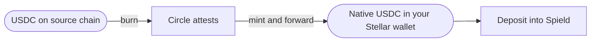

import { Callout } from 'fumadocs-ui/components/callout';
import { Step, Steps } from 'fumadocs-ui/components/steps';

If your USDC lives on another chain, Spield's cross-chain flows bring it to Stellar so you can
deposit, and send it back out when you exit. They run on **Circle CCTP V2**: USDC is **burned** on the
source chain, Circle **attests** the burn, and **native USDC is minted** to your Stellar wallet.
No wrapped asset is involved. For the feature overview, see
[Cross-chain bridge](/docs/features/cross-chain-bridge).

## Before you start

- Have **USDC** on a supported source chain: Ethereum, Base, Arbitrum, OP Mainnet, Polygon, Avalanche, or Solana.
- Have a little of that chain's **gas token** (for example ETH on Ethereum) to send the transaction.
- Have your **Stellar wallet** connected. It is the destination, and it needs a USDC trustline and a little XLM for the Stellar-side steps.

## Option 1: bridge on its own (Bridge page)

<Steps>

<Step>
### Open the Bridge page

Select **Bridge** in the Spield app sidebar. The card is titled **Bridge to Stellar**.
</Step>

<Step>
### Pick the source chain and connect that wallet

Choose where your USDC is now. The list shows whether each chain supports **Standard**, **Fast**, or
both. Then click **Connect Source Wallet**.
</Step>

<Step>
### Enter the amount and pick a speed

Type **Amount to bridge**. **You receive** shows the amount that will arrive after Circle's fee.
**Standard** waits for finalized confirmations on the source chain. **Fast** settles sooner using
Circle's faster attestation, at a fee that is shown before you confirm. Fast is available from
Ethereum, Base, Arbitrum, OP Mainnet, and Solana. Polygon and Avalanche use Standard.
</Step>

<Step>
### Confirm the recipient

The app shows a **Confirm final recipient** dialog. That Stellar address is permanently encoded into
the burn, so check it carefully before USDC leaves the source chain. Then approve in your source-chain
wallet. You may approve the token first, then the burn, which is two signatures on some chains.
</Step>

<Step>
### Receive on Stellar

When Circle's attestation is ready, the app mints native USDC to your Stellar wallet. You are now
ready to [deposit into Spield](/docs/getting-started/your-first-deposit).
</Step>

</Steps>

## Option 2: deposit straight from another chain

You do not have to bridge first. The **Vault, SR Wrapper, Liquidity, Deposit, and Markets** panels
(for both Blend and USTRY) have a **Pay with** menu. Pick a chain and the app runs the whole
thing as one **journey**: bridge in, then the deposit or trade, with a **How your funds move**
strip showing each hop.

- The USDC lands in **your own Stellar wallet** first, and the Stellar steps are signed by you.
- If the price or the vault terms move while your USDC is in transit, the journey **stops and asks you**. A buy that fills more than **2%** worse than the price you reviewed will not proceed on its own.
- When a Fixed Vault journey cannot continue (for example, the series filled up), you can choose **Another maturity**, or keep the USDC in your wallet.

## Option 3: send exits back out

Exits can end on another chain too. On the receipt Redeem button, the Deposit page's redeem mode,
Liquidity removal, and Markets sales, use the **Receive on** menu: **Stellar** (your wallet) or another
chain. The app unwinds the position on Stellar, then Circle sends the USDC to your wallet on the
destination chain. You sign once on the destination chain to receive it. On testnet, the market's
USDC is first converted 1:1 into Circle's test USDC, with at least 99% of the amount guaranteed.

## Journeys can be resumed, and funds never get stuck

Every journey checks the chain before each step and records where it is. Close the tab or lose your
connection and you can pick it up again from the journey card, or by pasting the source chain and
**burn transaction hash** into the resume box on the Bridge page.

- **No step repeats.** Before each Stellar step the app re-reads what already happened on-chain and never repeats one that did.
- **Funds stop in your wallet.** If anything pauses or you cancel, what you hold stays in your own Stellar wallet as plain USDC (or SR or USTRY), never inside a Spield contract on your behalf.
- **Fees are bounded.** Circle's fee is capped at the maximum shown before you confirm.

## Good to know

- **Timing varies** by source chain, speed, and network conditions. Circle's attestation is usually under a minute once the burn is final.
- **A single burn is limited to 10,000,000 USDC** by Circle.
- **Double-check the destination** is your own Stellar address before confirming.
- **Keep some XLM** in your Stellar wallet for the Stellar-side steps.

<Callout type="warn" title="Cross-chain carries its own risk">
  CCTP is separate infrastructure with its own risk profile. If you would rather avoid it,
  withdraw USDC directly on the Stellar network from an exchange. See
  [funding your wallet](/docs/getting-started/funding-your-wallet).
</Callout>
