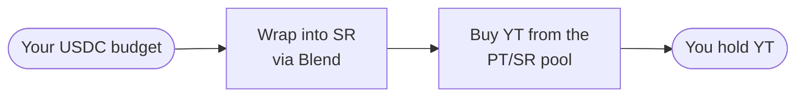

import { Callout } from 'fumadocs-ui/components/callout';
import { Step, Steps } from 'fumadocs-ui/components/steps';

Going "long yield" means betting that the **realized** yield will be **higher** than the
market's current **implied rate**. You express it by holding **YT**. This is the higher-risk,
higher-upside side of Spield.

<Callout type="warn" title="This is an advanced, higher-risk flow">
  YT can decay to zero by maturity if the position earns little. Only go long yield if you
  understand that you can lose the amount you put in. Read [Understanding the risks](/docs/resources/security)
  first.
</Callout>

## The idea in one line

Buy YT cheaply. If yields run hotter than the market expects, your YT earns more than you
paid. A small amount of USDC controls the yield of a much larger position. That is the
leverage, and because there is no borrowing, there is nothing to liquidate.

## What happens behind the click

The market is a PT/SR pool, and YT is bought through it. Buying a given amount of YT means the
pool mints PT and YT from SR, keeps the PT, and passes you the YT. You pay the difference. You
only name the budget; the app works out how much YT it buys.

## Walkthrough

<Steps>

<Step>
### Open Markets, then YT, then Buy

Select **Markets**. Under **Asset** choose **YT**, and under **Direction** choose **Buy YT**
(its sub-label reads "Leveraged on yield").
</Step>

<Step>
### Choose how you pay and your budget

The **Pay with** menu lets you pay in **USDC** (default), in **SR**, or in USDC from another chain.
The field reads **You spend (USDC max budget)**. The app shows:

- how much **YT** you receive,
- the leverage, for example "12.0x yield exposure, no liquidation risk",
- the **Actual cost to your wallet**. If the pool can fill less than your budget right now, the
  rest simply stays in your wallet.
</Step>

<Step>
### Sign

Paying with USDC takes **two signatures**: wrap USDC into SR, then buy YT. A Blend deposit and a
curve trade do not fit in one Soroban transaction. The **How your funds move** strip shows where you
are, and the button reads **Signature 1 of 2**, then **2 of 2**. If you already hold SR, or pay in SR,
it is just one. YT needs no trustline.
</Step>

<Step>
### Manage your YT

Your YT now earns yield until maturity. Claim accrued yield in USDC whenever you like (next
section). The YT keeps earning. To exit, choose **Sell YT** on Markets.
</Step>

</Steps>

## When does YT pay off?

YT is profitable when the yield it collects (plus any value left at exit) exceeds your net
cost. In short:

| Scenario | YT outcome |
| --- | --- |
| Realized yield **beats** the implied rate | YT wins. You captured the upside. |
| Realized yield is about the implied rate | Roughly break-even. |
| Realized yield **falls short** | YT underperforms. It can decay toward zero by maturity. |

YT also pays a **protocol yield fee** (5%) on the yield you collect, so what reaches you is net of it.
See [Protocol fees](/docs/features/protocol-fees).

## Claiming yield

You do not have to wait for maturity to take profit. Open the **Yield** page (under **Earn**).
It shows **Claimable now**, the **YT face held**, the **Protocol yield fee**, and **Already withdrawn**.
Click **Claim ... USDC**. Spield pays the accrued yield in USDC in one signature, and **your YT
is untouched**, so it keeps earning. Claim as often as you like.

After maturity the yield index freezes at expiry, and everything accrued up to then stays claimable
with no deadline.

## Exiting

- **Sell YT** on Markets, receiving **USDC** (two signatures: sell, then unwrap) or **SR** (one signature).
- **Combine** equal PT and YT into USDC on the Deposit page, if you hold both.

Selling YT **credits the yield you have earned without paying it out**, so after a sale it is still
claimable on the Yield page. A balance falling to zero is not a loss of that yield.

Next, the income side: [provide liquidity](/docs/guides/provide-liquidity).
