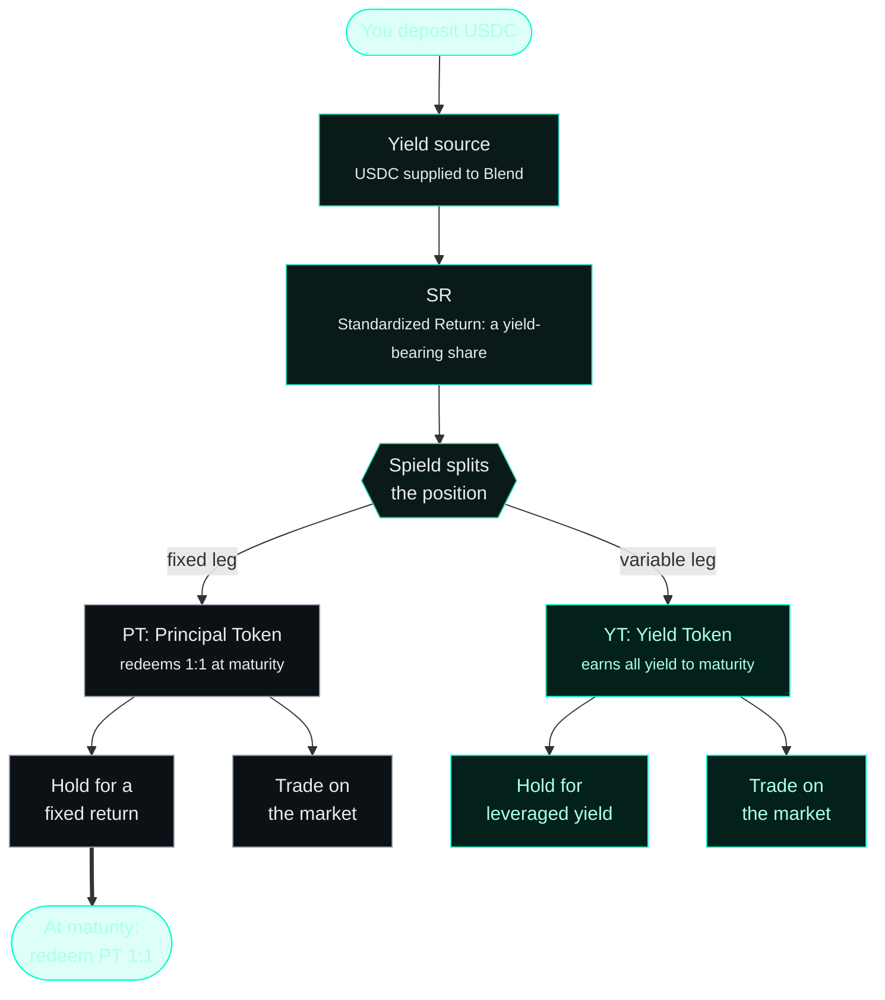

import { Callout } from 'fumadocs-ui/components/callout';
import { Card, Cards } from 'fumadocs-ui/components/card';

This section explains how Spield works at a level you can follow without reading any code. It
goes from a single deposit all the way to redemption.

## The big picture

Spield does three things, in order: it **sources** real yield, **splits** it into a fixed leg
and a variable leg, and lets you **trade or hold** each piece.

The key insight is that **the value behind your tokens is a real position that grows on its
own.** Spield never has to invent or top up a number. The backing increases as the underlying
lending position earns interest.

## The layers

Spield is built as a few independent layers. You only ever interact with the top ones. The
lower ones do the heavy lifting.

| Layer | What it does | You see it as |
| --- | --- | --- |
| **Yield source** | Supplies your USDC to Stellar's Blend lending market (or, on testnet, holds tokenized Treasuries) so it earns real interest. | "My deposit is earning yield." |
| **SR (Standardized Return)** | Wraps the yield source into one share token whose value only goes up. Everything above it speaks SR. | A hidden step, or a token you can hold. |
| **Tokenization** | Splits SR into PT and YT, and keeps the books for every holder. | "I hold PT and YT." |
| **Products and market** | The Fixed-Rate Vault (one-click fixed return) and the time-decay AMM (trading). | "I locked a fixed rate" or "I traded PT." |

Because the layers are separate, the simple products, like the Fixed-Rate Vault, work on
their own without the trading market. The [Router](/docs/how-it-works/standardized-return#the-router-staying-in-usdc)
lets you stay in USDC throughout.

## Each maturity is its own series

Spield runs in **series**. A series is a full, separate set of contracts with one fixed
maturity date that can never change. You pick a series in the app, and several can run side by
side. See [Series and maturities](/docs/how-it-works/series-and-maturities).

## Two yield sources

<Callout type="info" title="Blend today, tokenized Treasuries on testnet">
  Series on **mainnet** earn yield from the Blend USDC pool. A second family of series, built
  on Etherfuse **USTRY** tokenized US Treasuries, runs on **testnet** only for now. It uses the
  same PT and YT idea with different plumbing. See [Treasury series](/docs/how-it-works/treasury-series).
</Callout>

## Read on

<Cards>
  <Card title="PT and YT explained" href="/docs/how-it-works/pt-and-yt" description="What the two tokens are, how yield settles on every transfer, and the 5% yield fee." />
  <Card title="Standardized Return (SR)" href="/docs/how-it-works/standardized-return" description="The share token under everything, and why PT trades against SR rather than raw USDC." />
  <Card title="The yield source" href="/docs/how-it-works/yield-source" description="Where the real yield comes from and why the backing genuinely grows." />
  <Card title="Treasury series (USTRY)" href="/docs/how-it-works/treasury-series" description="The tokenized US Treasury family: NAV feed, exits that never wait on an oracle." />
  <Card title="Solvency" href="/docs/how-it-works/solvency" description="Why the protocol can always pay everyone, and how you can verify it live." />
  <Card title="The protocol lifecycle" href="/docs/how-it-works/lifecycle" description="A full timeline from deposit to maturity to redemption." />
  <Card title="Series and maturities" href="/docs/how-it-works/series-and-maturities" description="Immutable expiry, side-by-side series, and what works before and after maturity." />
</Cards>
