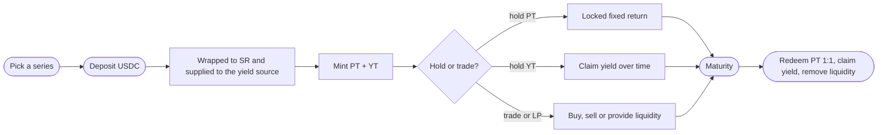

import { Callout } from 'fumadocs-ui/components/callout';
import { Step, Steps } from 'fumadocs-ui/components/steps';

This is the whole journey of value through Spield, end to end. Everything else in the docs is
detail on one of these stages.

## The timeline

## Stage by stage

<Steps>

<Step>
### Pick a series

Every maturity is its own **series**, with its own contracts and an expiry that can never
change. You choose one with the series selector in the app. See
[Series and maturities](/docs/how-it-works/series-and-maturities).
</Step>

<Step>
### Deposit

You deposit USDC. It is wrapped into [SR](/docs/how-it-works/standardized-return) and supplied
to the yield source, where it starts earning real interest. In return you receive equal
amounts of **PT** and **YT**, or, via the Fixed-Rate Vault, a single receipt for a guaranteed
payout. The app shows each step and how many wallet signatures it takes.
</Step>

<Step>
### Earn and manage (before maturity)

While the market is open you have choices:

- **Hold PT** to lock in a fixed return.
- **Hold YT** and **claim** its accrued yield whenever you like. The YT keeps earning.
- **Trade** PT or YT as your view changes.
- **Provide liquidity** (PT and SR) to earn swap fees.
- **Recombine** equal PT and YT back into the underlying to exit early.
</Step>

<Step>
### Approach maturity

As the date nears, prices converge predictably: **PT drifts up to par (1.0)** and **YT's claim
on future yield decays**. The market is built around exactly this path.
</Step>

<Step>
### Maturity

At the expiry timestamp, the series changes mode. Nothing can be created or traded any more:

- no new PT or YT can be minted,
- no swaps,
- no new liquidity can be added,
- the yield index freezes.

Anything that is an **exit** stays open.
</Step>

<Step>
### Redeem

After maturity you can:

- **Redeem PT 1:1.** You need only the PT. The Router can pay out in USDC.
- **Redeem a Fixed-Rate Vault receipt** for its full guaranteed payout.
- **Claim any unclaimed YT yield.** It never expires.
- **Remove liquidity** you provided, as PT and SR.

Your position is then complete.
</Step>

</Steps>

## What works before and after maturity

| Action | Before expiry | After expiry |
| --- | --- | --- |
| Wrap and unwrap SR | Yes (wrapping is limited by the deposit cap) | Yes. SR has no maturity of its own. |
| Mint PT + YT | Yes | **No** |
| Buy or sell PT and YT on the market | Yes | **No** |
| Add liquidity | Yes | **No** |
| Remove liquidity | Yes | **Yes** |
| Claim YT yield | Yes | **Yes**, no deadline |
| Recombine PT + YT | Yes | Not needed: PT alone redeems |
| Redeem PT 1:1 | Not alone (recombine instead) | **Yes** |
| Redeem a vault receipt | After its maturity only | **Yes** |

A matured series is **redeem-only**. Nothing is lost by waiting to redeem.

## A worked example

Say you deposit **1,000 USDC** into the Fixed-Rate Vault at a 3.00% fixed rate with 90 days to
go. The coupon is simple interest on the principal for the time remaining:
1,000 x 3.00% x 90 / 365, about 7.40 USDC.

| Moment | What happens |
| --- | --- |
| **Day 0** | Deposit 1,000 USDC. You get a receipt for a guaranteed payout of about 1,007.40 USDC at maturity. |
| **Days 1 to 89** | Your USDC earns real yield in the background. Your payout is already locked and does not change. |
| **Day 90 (maturity)** | You redeem the receipt for the full payout. |

The exact figures depend on the rate and term shown when you deposit. The point is that the
payout is **known and fixed from day 0**.

<Callout title="What if you want out early?">
  You are never locked in against your will on the PT and YT path: sell on the market or
  recombine PT and YT to exit any time. The fixed return is what you get if you *hold to
  maturity*. Leaving early means taking the current market price instead. A vault receipt
  redeems at maturity.
</Callout>

## Where to go next

- The products that wrap this lifecycle into one-click flows: [Features](/docs/features)
- A concrete walkthrough: [Redeem at maturity](/docs/guides/redeem-at-maturity)
- Build on top of it: [Developers](/docs/developers)
