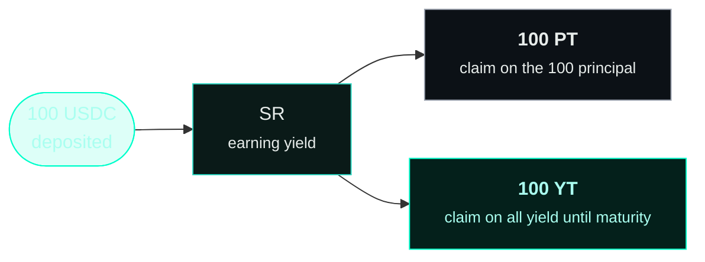
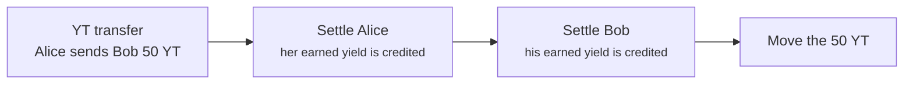
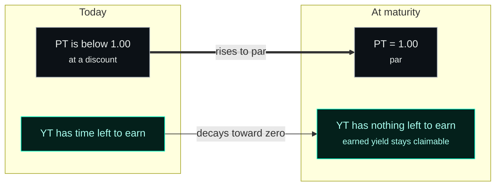

import { Callout } from 'fumadocs-ui/components/callout';
import { Tab, Tabs } from 'fumadocs-ui/components/tabs';

When you split a deposit, Spield mints two tokens in equal amounts: a **Principal Token (PT)**
and a **Yield Token (YT)**. This is the heart of the protocol, so here it is made concrete.

## The split

Say you deposit **100 USDC**. It is supplied to the yield source and wrapped into
[SR, the yield-bearing share token](/docs/how-it-works/standardized-return). Spield then
represents that position as two separate claims:

- **PT** is your claim on the **principal**. Each PT redeems for **1 USDC of value at maturity**.
- **YT** is your claim on the **yield**. It collects everything the position earns until maturity.

You now hold 100 PT and 100 YT. You can keep both, sell one, or trade them separately.

<Callout title="The invariant">
  **Value(position) = Value(PT) + Value(YT).** Splitting never changes the total value. It
  hands you two pieces you can manage independently.
</Callout>

## PT: the fixed-rate bond

A PT behaves like a **zero-coupon bond**:

- It is worth **1 USDC at maturity** (its "par" value).
- Before maturity it trades at a **discount**, for example 0.9926 USDC with 90 days to go.
- That discount is your **fixed return**. Buy at 0.9926, redeem at 1.00, keep the difference.

As maturity nears, a PT's market price drifts **up toward par (1.0)**, because it is getting
closer to being redeemable.

<Tabs items={['What you earn', 'When you can redeem']}>
<Tab value="What you earn">
Your return is fixed the moment you buy. If 1 PT costs 0.9926 and matures in 90 days, you earn
about **0.75% over 90 days**, which is about **3% a year**, whatever happens to rates afterward.
The market's own number for this is the **implied APY**.
</Tab>
<Tab value="When you can redeem">
PT redeems **1:1 at or after maturity**, and at that point you need only the PT (the YT is not
required). Before maturity you cannot redeem PT alone, but you can sell it on the market at its
current price, or recombine it with an equal amount of YT (see below).
</Tab>
</Tabs>

### What PT actually is on Stellar

PT is a **classic Stellar asset** with code `SPLDPT` (other series use their own codes), also
reachable as a Stellar Asset Contract. Because it is a classic asset, your wallet needs a
**trustline** to it, which the app adds for you.

Every series gets its **own fresh issuer account**, and that issuer is **locked** right after
setup: all its signer weights are set to zero, so no key can ever mint more. Only the series'
yield contract can mint PT, and only against real deposits. Because tickers repeat across
series, always compare the full `CODE:ISSUER` pair, never the code alone. The live pairs are
listed on [Addresses](/docs/developers/addresses).

## YT: the yield token

A YT is a claim on **all the yield** the position earns until maturity. It is cheap relative to
the exposure it represents, so it is a **leveraged** way to take a view on yield:

- A small amount of USDC buys YT covering the yield of a much larger position.
- If realized yield **beats** what the market expected, YT is profitable.
- If realized yield **falls short**, YT can end up worth little or nothing.

You can **claim** the yield a YT has accrued at any time. The claim pays out in USDC (via
SR), and the YT stays in your wallet and keeps earning until maturity.

<Callout type="warn" title="YT is the higher-risk leg">
  YT is for users with a view on yield. Its value falls toward zero as maturity approaches,
  and it can be worth less than you paid. That is the price of its leverage. Read
  [Understanding the risks](/docs/resources/security).
</Callout>

### YT is the yield contract itself

On Stellar, a classic asset has no hooks, so it cannot do anything when it moves. Spield needs
YT to do something on every move: **settle the interest earned so far**. So YT is not a classic
asset. **The yield contract is the YT token.** Its address is the YT address, and there is no
YT trustline to create.

Every time YT changes hands, mints, or burns, a hook runs first and settles **both** sides at
the current yield index:

What this guarantees:

- **Yield follows the token.** Alice cannot send Bob all her YT and still collect the yield
  going forward. What she earned before the transfer is hers. What accrues afterward belongs to
  whoever holds the YT.
- **A new holder never inherits old yield.** Bob earns only from the moment he receives YT.
- **One balance, no positions.** Ten purchases are still a single balance and a single claim.
- **YT is freely transferable**, so wallets, over-the-counter trades, other markets and
  multisigs all work correctly.

## How they relate over time

Holding yield expectations constant, this is the shape of a market's life:

- **PT climbs to par.** Its price rises predictably to 1.0.
- **YT decays.** The claim on *future* yield shrinks as time runs out. The yield it already
  earned stays claimable **with no deadline**, even after maturity.

This predictable "time decay" is exactly what the [yield market](/docs/features/yield-market)
prices.

## Recombining (exit early)

If you hold **equal amounts of PT and YT**, you can **recombine** them back into the
underlying at any time before maturity, because together they are just the original position
again. Any pending yield is credited first, so nothing is lost. After maturity you need only
PT.

## The yield fee

Spield takes a **5% yield fee**, charged on **YT interest** at the moment it is paid out to
you. It is never charged on principal, on PT, or on wrapping and unwrapping SR. The contract
caps the fee at 10%, so it can never be raised past that. Details and the full fee picture are
on [Protocol fees](/docs/features/protocol-fees).

## Recap

| | PT (Principal Token) | YT (Yield Token) |
| --- | --- | --- |
| Represents | Your principal | All yield until maturity |
| Redeems for | 1 USDC of value at maturity | Yield, claimable any time (5% fee) |
| What it is | Classic Stellar asset (needs a trustline) | The yield contract itself (no trustline) |
| Price over time | Rises toward par (1.0) | Decays as time runs out |
| Risk | Low, like a bond | Higher, leveraged on yield |
| Best for | Savers wanting certainty | Traders with a yield view |

Next: [Standardized Return (SR)](/docs/how-it-works/standardized-return), the token PT and YT
are built from.
