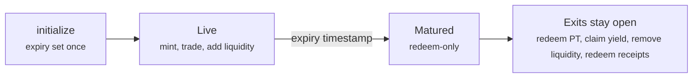

import { Callout } from 'fumadocs-ui/components/callout';
import { Tab, Tabs } from 'fumadocs-ui/components/tabs';

A **series** is one maturity of Spield. It is a complete, separate stack of contracts with a
single expiry date, and the date is fixed forever when the series is created.

## What a series contains

Every Blend series has the same six contracts:

| Contract | Role |
| --- | --- |
| **SR** | The yield-bearing share token, and the series' deposit cap |
| **Strategy** | The Blend adapter that holds the position |
| **Yield** | The PT and YT engine. Its address is the YT token |
| **SR Market** | The PT/SR trading pool |
| **SR Vault** | The Fixed-Rate Vault for this maturity |
| **SR Router** | The one-signature USDC front door |

Each series also has its **own PT asset** from a **fresh issuer account that locks itself**,
so only that series' yield contract can ever mint its PT. Two series both use the ticker
`SPLDPT`, but they are **different assets**: always compare the full `CODE:ISSUER`. Treasury
(USTRY) series are structured differently, see [Treasury series](/docs/how-it-works/treasury-series).

## The expiry is immutable

The expiry is set **once**, when the series is initialized. There is no function to extend, move
or roll it. If you want a new maturity, a **new series is deployed**.

This is deliberate. PT is worth exactly 1 USDC *on a particular date*. If an admin could move
the date, the fixed rate you locked would mean nothing.

## Before and after maturity

| | Live | Matured |
| --- | --- | --- |
| Mint PT and YT | Yes | No |
| Swap PT or YT | Yes | No |
| Add liquidity | Yes | No |
| Redeem PT for USDC | Recombine with YT | Yes, PT alone |
| Redeem vault receipts | After maturity | Yes |
| Claim YT yield | Yes | Yes, no deadline |
| Remove liquidity | Yes | Yes |

A **matured series is redeem-only**. Nothing new can start in it, but everyone who is owed
something can still collect, with no deadline and no price to wait for. The walkthrough is
[Redeem at maturity](/docs/guides/redeem-at-maturity).

## Several series run side by side

Series are independent, so more than one can be live at once, for example a short one and a
longer one. Each has its own pool, prices and implied rate, its own vault rate, its own caps, and
its own PT. You can hold positions in several, and one series maturing has no effect on another.

When a series matures, nothing rolls over automatically. You redeem it, and if you want to stay
invested you deposit into a newer series.

## Choosing a series in the app

The app's header has a **series selector**. It lists series in two groups:

- **Live Now**: open for deposits, trading and liquidity.
- **Ended**: matured series, still open for inspection and for redeeming PT and vault receipts.

Each entry shows its duration, maturity date and time left (or how long ago it matured). The app
opens on the live Blend series with the most time remaining. If every series has ended, it shows
the newest one so you can still redeem. When a series has matured, its trade and deposit panels
stand down and point you to the exit. A separate control switches between the **Blend**
(USDC) and **Treasury** (USTRY) families.

New series are announced in the app. They also show up in the SDK's hosted series list, so
integrators can pick them up without upgrading the SDK (see the [SDK](/docs/developers/sdk)).

## Examples

<Tabs items={['Mainnet', 'Testnet']}>
<Tab value="Mainnet">

Three mainnet series are **live**, launched on 27 November 2026:

| | Blend USDC Series 3 | USTRY Series 1 | USTRY Series 2 |
| --- | --- | --- | --- |
| Asset | USDC on Blend | Etherfuse USTRY | Etherfuse USTRY |
| Length | 30 days | 30 days | 60 days |
| Matures | 2026-12-27 17:41 UTC | 2026-12-27 17:49 UTC | 2027-01-26 17:51 UTC |
| Opening rate | 3.00% (vault 3.00%) | 3.50% | 3.50% |
| Cap | 50 USDC | 36 USTRY split, 10 USTRY deposit | 300 USTRY split, 50 USTRY deposit |

Their pools are small at launch, so read the quote before a large trade.

Two earlier Blend series have **matured** and are **redeem-only**:

| | Series 1 | Series 2 |
| --- | --- | --- |
| Launched | 2026-09-01 | 2026-10-12 |
| Length | 30 days | 15 days |
| Matured | 2026-09-30 23:09 UTC | 2026-10-26 23:12 UTC |
| Vault fixed rate | 3.00% | 3.00% |
| Deposit cap at launch | 50 USDC | 160 USDC |

Each series is a separate deployment, with its own contracts and its own PT. All mainnet
addresses are on [Addresses](/docs/developers/addresses).

</Tab>
<Tab value="Testnet">

Testnet runs short series so you can walk a full cycle (deposit, trade, mature, redeem) quickly.
They are launched often, and older ones mature and become redeem-only, so **choose the live series
in the app** or call `listSeries({ status: 'live' })` in the SDK rather than relying on a
fixed name. A Treasury (USTRY) series runs on testnet as well.

</Tab>
</Tabs>

<Callout type="info" title="Guarded launch caps">
  Each series launches with a deposit cap on SR, a guardrail because the contracts are unaudited.
  A cap only limits new deposits. It never blocks redemption. See
  [Solvency](/docs/how-it-works/solvency#per-series-caps).
</Callout>

Next: [protocol fees](/docs/features/protocol-fees), or start from the
[lifecycle](/docs/how-it-works/lifecycle).
