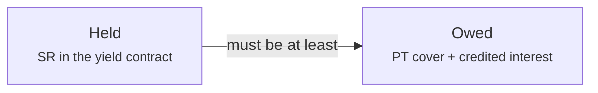

import { Callout } from 'fumadocs-ui/components/callout';

"Solvent" means the protocol holds enough to pay back everyone it owes. Spield is built so this
is checked **on every operation** and so that **anyone can verify it** at any time. Each series
is its own set of contracts with its own books, so solvency is a per-series property.

## The invariant

<Callout title="The solvency invariant">
  **What the series holds is at least what it owes.** The SR held by the yield contract is
  always at least the SR needed to cover every PT at par, plus every unit of interest already
  credited to YT holders but not yet withdrawn.
</Callout>



## PT cover

Every PT is a claim on 1 USDC of value. Because SR's value in USDC rises over time, **the SR
needed to cover a PT shrinks as the rate rises**:

```text
PT cover (in SR)  =  total PT face  /  current index
```

When someone splits SR into PT and YT, the contract keeps all of that SR and mints PT and YT
against it. The PT leg is covered at par from the first moment, and as the index rises the
cover needs *less* SR than is held. The difference is the next section.

## The conservation identity

The surplus is not slack. It has an exact owner. If you mint with `sr_in` SR when the index is
`i0`, the face minted is `sr_in x i0`. Later, at index `i`:

```text
held  -  PT cover   =   sr_in  -  (sr_in x i0 / i)
```

and that figure is **exactly what the YT holders are owed**. Put plainly:

<Callout title="Every unit above PT cover belongs to a YT holder">
  There is no growing pot of unowned money. Whatever the series holds beyond PT cover is
  interest that YT holders have earned, whether they have claimed it or not.
</Callout>

This is why a claim can always be paid: the interest being claimed was already sitting in
the surplus.

## After expiry

At expiry the yield index **freezes**. No new PT or YT can be minted, and YT stops earning from
that moment. Spield reconstructs the index at the exact expiry timestamp from the last reading
before expiry and the first reading after it, so a late call does not credit the delay to
anyone.

What happens to the surplus afterward:

- **It is still owed to YT holders.** Interest earned before expiry stays claimable
  **with no deadline**.
- **It is not protocol revenue.** The only thing that can be swept to the treasury after expiry is
  money that is provably owed to nobody: rounding remainders, and interest **abandoned** by
  burning YT without claiming it. A healthy series sweeps close to nothing, which is the
  correct answer. The sweep is bounded so it can never reach PT cover or any credited claim.
- **PT redemption does not change.** PT redeems 1:1 against its own cover, whenever you
  choose to redeem.

## Checked on every operation

The contracts **re-check the invariant after every state change** that touches the books: every
mint, redeem, interest payout and surplus sweep. A transaction that would leave the series
under-covered fails and is rejected. There is a tiny rounding allowance of a few stroops, because
every payout rounds down, and a real accounting error would move whole units, nowhere near it.

The other contracts keep their own checks:

| Contract | What it asserts |
| --- | --- |
| **Fixed-Rate Vault** | PT held is at least the total of all promised payouts, so every receipt is payable. |
| **PT/SR market** | Recorded reserves never exceed what the pool actually holds. |
| **Treasury series (USTRY)** | USTRY held is at least unsplit receipts plus the backing behind PT and YT. |

## Per-series caps

Every series launches with a **deposit cap**. On a Blend series the cap lives on SR and limits how
much can be wrapped in that series. It is measured on **cost basis** (what has been deposited
and not withdrawn), so yield never slowly closes deposits, and the "room left" figure is exact.

- It gates **deposits only.** Unwrapping, redeeming and claiming never check it, so lowering a
  cap can never trap anyone.
- Mainnet Series 1 launched with a 50 USDC cap and Series 2 with 160 USDC.
- Treasury series carry two caps: one for unsplit receipts and one for the backing behind
  PT and YT.

A cap is the main mitigation for the fact that the contracts are **not audited**. It bounds how much
any single series can lose.

## How you can verify it live

You do not have to trust any of this. The yield contract exposes a public `solvency()` view that
returns, straight from the chain:

| Figure | Meaning |
| --- | --- |
| **Held** | SR the yield contract holds. |
| **Required** | PT cover plus credited interest. |
| **Surplus** | Held minus required. |

The app's **Solvency** page converts these into USDC and shows **Backing**, **Principal** (PT
face outstanding), **Surplus**, and a collateralization ratio. For a Treasury series the same page
shows USTRY held against obligations, measured in USTRY. See
[Solvency dashboard](/docs/features/solvency-dashboard) and
[Reading protocol state](/docs/developers/reading-state).

## What solvency does *not* cover

Being solvent means the series holds what it owes **in the yield source's terms**. It does not
remove every risk:

- If **Blend** took a real loss or ran short of free liquidity, the value of SR would fall or
  exits would be delayed. Losses are shared pro rata, not hidden.
- For **USTRY**, "covered" means covered in tokens, not dollars.
- **Smart-contract risk** always exists, and these contracts are unaudited.

See [Understanding the risks](/docs/resources/security).

Next: [the full protocol lifecycle](/docs/how-it-works/lifecycle).
