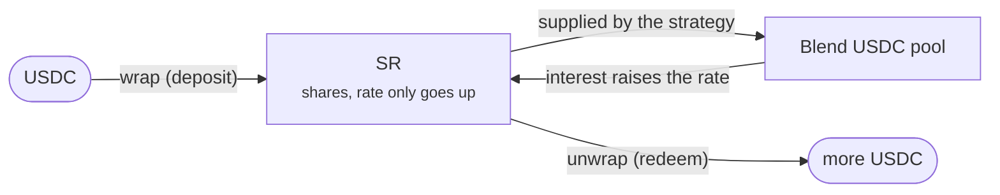

import { Callout } from 'fumadocs-ui/components/callout';

**SR, short for Standardized Return, is the token everything in a Spield series is built on.**
It is Spield's version of the standardized yield wrapper used by Pendle (the SY token, from
the EIP-5115 standard). One token, one interface, in front of a yield source.

You can use Spield without ever knowing SR exists, because the app and the Router handle it.
But if you build on Spield, trade PT and YT, or provide liquidity, it helps to know what is
underneath.

## What SR is

SR is a **share** token, not a 1:1 wrapper. You deposit USDC and receive SR. The **number of SR
you hold never changes**, but **each SR is worth more USDC over time**. That growth is the yield.

```text
USDC value of your SR  =  your SR balance  x  exchange rate
```

The exchange rate comes straight from the yield source. For a Blend series, SR shares map
one-to-one to the position Spield holds in the Blend pool, so SR's rate is Blend's own supply
rate index. No one sets it by hand.



Three properties matter:

- **The rate never goes down.** SR remembers its highest rate, so a temporary dip at the yield
  source shows up as "SR stops growing for a while" rather than everything above it repricing
  downward.
- **You can always unwrap.** SR has no maturity. Redemption is open at any time, even when
  deposits are paused. The admin can pause new deposits only. Nothing in SR lets the admin move
  your balance.
- **There is a per-series deposit cap.** The cap limits how much can be wrapped (see
  [Solvency](/docs/how-it-works/solvency#per-series-caps)). It never blocks an unwrap.

## What SR is for

SR does three jobs in the protocol.

1. **It is the adapter seam.** PT, YT, the market and the vault speak only SR. Supporting a new
   yield source means a new SR in front of it, not a change to anything above.
2. **Its rate is the single yield reference.** All PT and YT accounting runs on this one
   number.
3. **It is half of the trading pool.** The market is PT against SR (next section).

## Why PT trades against SR, not raw USDC

A natural design would be a PT/USDC pool. Spield deliberately does not do that.

<Callout title="The USDC half of a PT/USDC pool sits idle">
  In a pool holding PT and plain USDC, the USDC earns nothing while it waits for trades. In a
  PT/SR pool, the SR half **keeps earning the Blend yield the whole time it sits there**. For
  liquidity providers that is real extra return on top of swap fees, and it is the main reason
  the market is built this way.
</Callout>

There is a second reason. SR is the only token whose value tracks Blend's rate. Pricing PT
against anything else would put a moving conversion rate inside the price curve. Pricing PT
against SR keeps the curve clean: both sides are "units of the same position".

You never have to hold SR to trade, though. That is what the Router is for.

## The Router: staying in USDC

Users have USDC, not SR. A product that asked you to wrap first would make you learn its
internals before you could use it. The **Router** closes that gap.

| Router action | What happens | Signatures |
| --- | --- | --- |
| Buy PT with USDC | USDC is wrapped to SR, SR is swapped for PT, PT is delivered to you | 1 |
| Sell PT for USDC | PT is swapped for SR, SR is unwrapped, USDC is delivered | 1 |
| Sell YT for USDC | YT is swapped for SR, then SR is unwrapped | 2 in the app (sell, then unwrap) |
| Redeem for USDC | Burns PT (and YT before maturity), unwraps, delivers USDC. This is the **post-maturity exit**, since the market stops trading at expiry | 1 |
| Claim yield to USDC | Pays the YT yield you have earned in USDC without burning your YT | 1 |
| Buy YT with USDC | Wrap, then buy YT from the market | 2 in the app (see below) |

<Callout type="info" title="Why buying YT with USDC takes two signatures">
  Wrapping USDC into SR means a call into the Blend pool, and Blend's pool is memory-heavy. A
  Blend supply plus a YT purchase together exceed what one Stellar transaction is allowed to
  use. So the app wraps first, then buys, and shows you both steps before the first wallet
  prompt. **If you already hold SR, buying YT is a single signature.**
</Callout>

The app shows this as a **"How your funds move"** strip on the trade panel. Each hop is
listed (USDC to SR to PT, for example) with the number of wallet signatures it takes. On the
Blend trade panel you choose what you **pay with** (USDC or SR) and what you **receive in**
(USDC or SR).

### Three safety properties of the Router

1. **It holds nothing.** Every route ends with a check that the Router's own balances are
   back at zero. Nothing can get stuck in it, and nothing is left for a later trade to sweep up.
2. **It has no privileges.** It has no admin rights over SR, the yield contract, the market or
   the vault. If it were compromised, the worst case is mishandling funds you authorised inside
   one call, which is why every route carries a minimum-output guard on your side.
3. **You can bypass it.** Wrapping, swapping and redeeming are all directly callable. Pausing
   the Router removes convenience, never access.

## Holding SR directly

Holding SR is a legitimate position in its own right: a **yield-bearing dollar with no
maturity**. The app's **SR Wrapper** page lets you wrap USDC into SR and unwrap it again.
Reasons to do it:

- You want Blend yield without choosing a maturity.
- You want to buy YT in one signature.
- You want to prepare SR for providing liquidity.

<Callout type="warn" title="Know what the displayed value means">
  SR remembers its highest rate. In normal operation the value shown for your SR is exactly
  what you can unwrap. If the yield source ever took a real loss, the remembered rate would
  stay at its old high and the displayed value would then be an **upper bound**, while an
  unwrap would pay the lower real amount, shared pro rata among all SR holders. The app
  compares the two and warns you. See
  [Understanding the risks](/docs/resources/security).
</Callout>

## For developers

SR exposes `deposit`, `redeem`, `exchange_rate`, `preview_deposit`, `preview_redeem` and a
standard SEP-41 token surface. The full contract list is on
[Contracts](/docs/developers/contracts), and the TypeScript SDK wraps these routes for you
([SDK](/docs/developers/sdk)).

Next: [where the yield comes from](/docs/how-it-works/yield-source).
