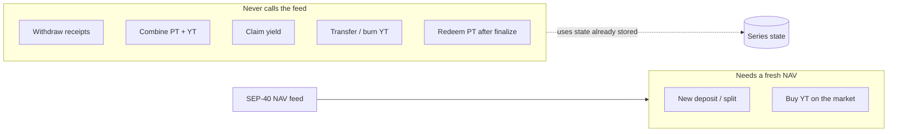

import { Callout } from 'fumadocs-ui/components/callout';

<Callout type="warn" title="Live on mainnet, unaudited">
  Two Treasury series are live on **Stellar mainnet** with Etherfuse's real USTRY
  (`USTRY:GCRYUGD5…`), launched on 27 November 2026: **USTRY Series 1** (30 days, matures
  27 December 2026) and **USTRY Series 2** (60 days, matures 26 January 2027). Their pools are small
  at launch. Testnet runs the same contracts with sandbox USTRY. The contracts are unaudited.
</Callout>

Alongside the Blend USDC series, Spield has a second family built on **Etherfuse USTRY**, a
tokenized US Treasury product. The idea is the same: split a yield-bearing asset into a
fixed-principal leg (PT) and a yield leg (YT). The plumbing is different, because USTRY earns
through a **rising price**, not a lending rate.

## The two ideas to hold on to

1. **PT is a USD claim, paid in USTRY.** Each PT stands for $1 of face value, backed by
   however many USTRY tokens that is worth. Payouts are in **USTRY tokens**, not dollars.
2. **YT earns the USTRY that growth frees up.** As USTRY's price rises, fewer tokens are needed
   to back the same dollar face. The leftover tokens belong to YT holders.

A worked example. You split 100 USTRY when its NAV (net asset value per token) is $1.10:

| Step | PT side | YT side |
| --- | --- | --- |
| Split at NAV $1.10 | $110 of face, backed by 100 USTRY | Claim on whatever growth frees up |
| NAV rises to $1.122 | Needs only about 98.04 USTRY for $110 | About 1.96 USTRY freed and credited to YT |
| At maturity | Redeems for the USTRY that cover $110 at the final NAV | Claims its accrued USTRY |

## Where the price comes from: a SEP-40 NAV feed

The series reads USTRY's NAV from a standard **SEP-40 price feed**. On mainnet it is
**RedStone's** feed (`CBMGLKUQ…WYRF`), so Spield runs no oracle there. On testnet it is a
Spield-run feed with the same interface, so the series code is identical on both.

The series keeps a **high-water mark** of NAV with these rules:

- **It never falls.** If the feed prints a lower price, the mark stays where it was. PT's token
  allocation is set by the high-water mark, so a dip cannot take tokens away from PT holders.
- **Its rise is capped.** Each series has an annual growth ceiling (`max_apr_bps`: 8% a year on
  the mainnet series, 20% on testnet Series 2). The mark can rise at most that fast, bounded in two ways: step by step
  (from the last price actually used) and in total (a straight line from the first price).
  A spiked or faulty feed print therefore cannot shift principal to YT faster than the ceiling.
- **It is never priced from DEX trades.** Only the feed counts.
- **The app rejects stale prices.** A NAV older than the series' maximum age (25 hours on the
  mainnet series, which covers RedStone's 12-hour heartbeat; 13 hours on testnet) is not accepted
  for new deposits.

## Exits never ask the oracle

This is the biggest change from testnet Series 1 and the core design rule of every v2 treasury series:

Only **new exposure** (a deposit or split, and therefore a YT purchase) reads the feed. Everything
you do to **get out** uses the state the series already stored. A feed that is late, wrong,
broken or hostile can pause new deposits. It cannot freeze your exit. Anyone can also call a
permissionless `sync()` to fold the newest prices into the stored state, so claims stay current.

## Receipts, PT and YT

A USTRY series has three claim tokens, all SEP-41 contract tokens (no classic trustline, though
your wallet needs a trustline to **USTRY** itself):

| Token | What it is |
| --- | --- |
| **sUSTRY** (receipt) | An unsplit deposit. Redeems 1:1 for USTRY, any time, needs no price. |
| **PT-USTRY** | The USD-face principal leg. |
| **YT-USTRY** | The yield leg. Transfers settle both sides, as on the Blend series. |

You can park USTRY as a sUSTRY receipt (no price needed) or **split** straight to PT and YT.
Receipts and splits have **separate caps**, so receipts parked by one person cannot block others
from splitting.

## Maturity: finalize, and the grace period

After expiry the series must be **finalized** before PT-only holders can redeem. Finalizing is
**permissionless**, and the app shows an "Awaiting finalization" card with a button. It can
happen two ways:

- **On a post-expiry price.** Once a feed sample dated at or after expiry exists, finalization
  uses the stored high-water mark (the app first folds in the latest prices, which is why it
  can take two signatures).
- **After the grace period.** If no such sample ever arrives, finalization still works once the
  grace period has passed (7 days on the mainnet series, 3 days on testnet Series 2), and **does
  not call the oracle at all**.
  No feed behaviour can stop a series from finalizing.

Yield credited before expiry stays claimable with no deadline. After finalization PT redeems
for its USTRY allocation, and YT is no longer needed.

## Trading: the PT/USTRY market

A series can have a **PT/USTRY market** (an AMM using the same time-decay curve as the Blend
market). PT trades against **genuine USTRY**, which itself accretes, so the pool's other side
keeps earning. See [The yield market](/docs/features/yield-market) for how the curve and fee work.

- PT swaps, YT sales and liquidity exits always work.
- **Buying YT** mints new exposure, so it needs a fresh NAV that is not below the high-water
  mark. It waits for the feed otherwise.

## Paying in USDC, USTRY or sUSTRY

In the app you choose what you pay with and what you receive:

| Choice | How it works | Signatures |
| --- | --- | --- |
| **USTRY** | Goes straight into (or out of) the series. No swap. | 1 |
| **sUSTRY** | Receipts you already hold. For market trades. | 1 |
| **USDC** | Swapped to USTRY on the Stellar DEX first, then the series call. A Soroban call cannot share a transaction with a DEX path payment. | 2 |

Cash exits that go back to USDC depend on **order-book liquidity** on the Stellar DEX. Spield does
not redeem USTRY for dollars itself. Bridging USDC from other chains into a USTRY position is
supported too (see [Cross-chain bridge](/docs/features/cross-chain-bridge)).

## What went wrong with Series 1, and what v2 changed

Testnet **USTRY Series 1** matured on 2026-11-10. Its design needed a fresh price for every
priced action, including exits, and for finalization. The price feed fell behind, and because that
contract had no upgrade path, its remaining payouts are **permanently locked**. It holds sandbox
tokens only, but it taught the lesson that became the v2 rules: exits and finalization must
never depend on a live oracle. USTRY **Series 2** is built that way, with a standard feed
interface, a capped high-water mark, a grace-period finalize, separate caps, and two-step admin
changes with a timelock.

## Risks to understand

<Callout type="warn" title="Read these before you try it">
  - **USD face is not a principal guarantee.** PT pays USTRY tokens. If USTRY's real NAV falls
    below its high-water mark, those tokens are worth fewer dollars.
  - **The issuer has controls.** The USTRY issuer can freeze or **claw back** tokens. A clawback
    from a Spield contract can freeze that contract's USTRY payouts or stop a pool from trading
    (liquidity providers can still exit pro rata).
  - **New deposits depend on the feed.** A stale or missing price pauses new deposits, never exits.
  - **Cash-out depends on DEX liquidity.**
  - **Unaudited.** The mainnet series launched with small caps as a guarded launch.
</Callout>

## Try it

Follow the walkthrough in [Treasury yield](/docs/guides/treasury-yield). To integrate,
see the [SDK](/docs/developers/sdk).

Next: [solvency](/docs/how-it-works/solvency).
