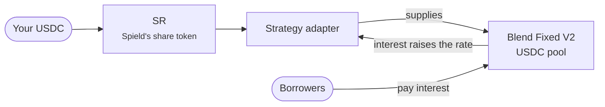

import { Callout } from 'fumadocs-ui/components/callout';

Spield does not manufacture yield. It **sources** real yield and restructures it. Knowing the
source is the key to knowing what you are exposed to.

## Your USDC earns real interest on Blend

Series on mainnet source their yield from the **Blend Fixed V2 USDC pool**, the lending
market on Stellar. Borrowers pay interest to use that liquidity, and suppliers (that is your
position) earn it. This is ordinary, transparent lending-market yield.

Spield only ever **supplies** USDC. It never borrows. That keeps the protocol's exposure
simple and one-directional.

## The strategy adapter

Each series has a **strategy** contract. It is the only part of Spield that knows how Blend
works, and it is deliberately thin:

- It holds the series' **own supply position** in the Blend pool. Only the series' SR token can
  deposit into or redeem from it, and only funds that SR directs.
- It reads the **live Blend supply rate index** straight from the pool. The rate is never pushed
  in by a key, so nobody can inflate it.
- It applies a **sanity bound** to that rate, so an impossible jump is rejected instead of
  being trusted.
- It has **no pause of its own**. Exits are outflows from the pool, and there is nothing a
  pause should block, so there is nothing to trap funds with.
- It can report how much of the position Blend can pay out *right now* (free liquidity), which
  lets the app offer a partial exit when the pool is tight instead of failing.

Everything above the strategy speaks [SR](/docs/how-it-works/standardized-return), so a different
yield source only needs a different strategy and SR in front of it.

## Why the backing genuinely grows

In the lending market, your supplied USDC is represented by a balance whose **exchange rate
rises over time** as interest accrues. Think of a savings-account share price that only ticks
upward: the same number of shares is worth more USDC each day.

That means the asset behind your tokens **grows on-chain, on its own**. Spield reads that
real rate directly from the lending market.

<Callout title="This is the difference that matters">
  Because the backing is a real position whose value rises automatically, Spield can pay every
  PT holder their principal and every YT holder their yield. The accounting is built so that
  what is owed never exceeds what is held. See [Solvency](/docs/how-it-works/solvency).
</Callout>

## "The rate" is the yield

The lending market's rising rate **is** the yield in Spield:

- **PT holders** get their principal back because the position always holds at least enough to
  cover it.
- **YT holders** get the *growth*: the difference between what the position is worth now and
  what it was worth when their YT was minted or last settled.

When a YT holder claims, Spield pays out exactly the grown amount (less the
[5% yield fee](/docs/features/protocol-fees)) and leaves the principal backing untouched.

## The Fixed-Rate Vault's rate is checked against Blend

The [Fixed-Rate Vault](/docs/features/fixed-rate-vault) promises a fixed rate funded by the yield
its inventory earns in Blend. A promise higher than Blend pays would slowly eat the vault's
spare capacity, so before a vault is launched its rate goes through a **calibration gate**:

1. The Blend pool's current **supply rate is measured** from the pool itself, not assumed.
2. That rate is reduced by the **yield fee**, because the vault earns net of it.
3. The vault's fixed rate must sit **below** the net figure with a safety margin, or the
   launch stops.

The gate runs at deployment and compares against the live pool. The contract separately
enforces a hard **ceiling** on the vault rate (20%) and, always, that every promised payout is
backed by principal tokens the vault already holds. Series 2 on mainnet cleared the gate at a
3.00% fixed rate.

## What Spield inherits from the yield source

Sourcing yield from an external market means Spield depends on that market's health. This is
the plain version:

- **If Blend keeps functioning normally,** Spield works as designed.
- **If Blend's free liquidity runs low,** withdrawals can be partial until borrowers repay.
  You can take what is available and return for the rest. Exits keep what they collect.
- **If Blend took a real loss (bad debt),** the loss would be shared pro rata across holders
  of SR rather than hidden. Spield cannot make that up, and the app discloses this on its
  Solvency page.

Spield limits its exposure by supplying to a deep, established pool, never borrowing,
capping each series' deposits, and continuously checking that its real position covers
everything it owes. See [Understanding the risks](/docs/resources/security) for the full list.

<Callout type="info" title="A second yield source: tokenized Treasuries">
  Alongside Blend, Spield has a second series family built on **Etherfuse USTRY**, a tokenized
  US Treasury product. It uses different plumbing (a NAV price feed instead of a lending rate)
  and is **testnet only today**. Read [Treasury series](/docs/how-it-works/treasury-series).
</Callout>

Next: [how the Treasury series work](/docs/how-it-works/treasury-series), or jump to
[solvency](/docs/how-it-works/solvency).
