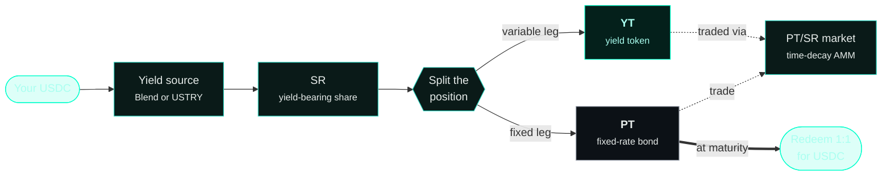

import { Callout } from 'fumadocs-ui/components/callout';
import { Accordion, Accordions } from 'fumadocs-ui/components/accordion';

You only need a few terms to use Spield with confidence. Here they are, in plain language.
For a full alphabetical list, see the [Glossary](/docs/resources/glossary).

## The three tokens

### SR: Standardized Return

**SR is a yield-bearing share of the yield source.** You deposit USDC and receive SR. The
number of SR you hold stays flat, but each SR is worth more USDC over time. That growth *is* the
yield. SR is Spield's counterpart to Pendle's SY, and every contract above it (the PT/YT
engine, the market) speaks only SR.

Most of the time you never have to touch SR: the app wraps and unwraps it for you inside a
trade. You can also hold it directly in the **SR Wrapper**. See
[Standardized Return (SR)](/docs/how-it-works/standardized-return).

### PT: Principal Token

A **PT is a fixed-rate bond**. Each PT redeems for **exactly 1 USDC at maturity**. You buy
it *today* for a little less than 1 USDC, and the gap is your fixed return.

> Example: if 1 PT costs **0.97 USDC** today and matures in 90 days, holding it to
> maturity returns **about 3.1%** over those 90 days, locked in the moment you buy.

### YT: Yield Token

A **YT is a claim on all the yield** the underlying position earns until maturity. It is
cheap, so a small amount of USDC buys exposure to the yield on a much larger position. That
is the "leverage." If realized yield beats expectations, YT wins. If it underperforms, YT
can decay toward zero.

<Callout title="The invariant that ties them together">
  At every moment, **value of the position = value of PT + value of YT**. The protocol never creates
  or destroys value when it splits a position. It only separates it.
</Callout>

## Series, maturity, and time

<Accordions type="single">
  <Accordion title="Series">
    A **series** is one maturity, deployed as its own stack of contracts (SR, strategy, yield
    engine, market, vault, router). Each series has its **own PT asset** and its **own expiry**.
    A new maturity means a new series. Nothing "rolls over". See
    [Series and maturities](/docs/how-it-works/series-and-maturities).
  </Accordion>
  <Accordion title="Maturity">
    The fixed date when PT becomes redeemable 1:1 and YT stops earning. A series' maturity is set
    once, when it is created, and **can never be changed**. After maturity there are no new
    mints, no swaps, and no new liquidity, but redeeming PT, redeeming vault receipts,
    claiming YT yield, and removing liquidity all keep working.
  </Accordion>
  <Accordion title="Par (1.0)">
    The face value of a PT, which is exactly 1 USDC. As maturity approaches, a PT's market price
    drifts **up to par**, because it is about to be redeemable for a full 1 USDC.
  </Accordion>
  <Accordion title="Discount">
    How far below par a PT trades today (for example 0.97). A bigger discount means a higher fixed
    return for buyers, and reflects a higher expected yield.
  </Accordion>
  <Accordion title="Fixed rate">
    The annualized return you lock in by buying PT now and holding to maturity, or by depositing
    in the Fixed-Rate Vault. It comes from the discount you actually paid and the time left. It
    does **not** change after you buy.
  </Accordion>
  <Accordion title="Implied rate">
    The market's *current* view of future yield, read off the PT price in the PT/SR pool. It
    moves as people trade. Buying YT is essentially betting that **realized** yield will beat
    the **implied rate**.
  </Accordion>
</Accordions>

## The pieces of the protocol

| Concept | What it is |
| --- | --- |
| **Yield source** | Where the real yield comes from: Blend USDC on mainnet and testnet, and Etherfuse USTRY (tokenized Treasuries) on testnet. |
| **Fixed-Rate Vault** | The simplest product: deposit USDC, get a receipt for a fixed payout at maturity. You never touch PT or YT directly. |
| **PT/SR market** | The trading venue (a time-decay AMM) where PT is bought and sold against SR. YT is traded through the same pool. |
| **Router** | A convenience contract that lets you pay and receive in plain USDC, wrapping and unwrapping SR in the same transaction. |
| **Liquidity** | PT plus SR supplied to the market to earn swap fees. |
| **Guarded Launch Cap** | A per-series ceiling on total SR deposits. Launch caps are small on purpose. |
| **Solvency** | Live, on-chain proof that what the protocol holds covers everything it owes. |

## Protocol fees

Spield takes two protocol fees, both bounded by hard ceilings written into the contracts:

- **Yield fee: 5%** of the yield YT holders collect (ceiling 10%).
- **Swap-fee split: 20% to the treasury, 80% to liquidity providers** (the treasury share has a
  ceiling of 50%).

The swap fee itself scales with time to maturity. See [Protocol fees](/docs/features/protocol-fees)
for the full picture.

## How they fit together

Once these click, the rest of the docs is just detail. Next: [Key benefits](/docs/introduction/key-benefits)
or the deeper [How It Works](/docs/how-it-works).
